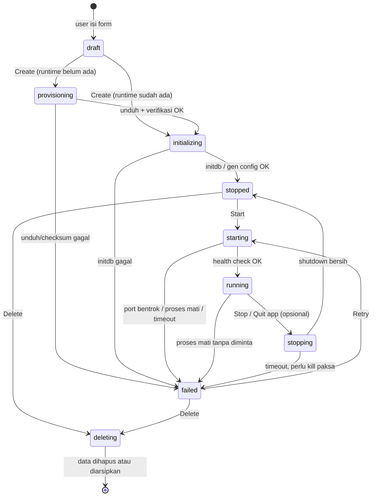
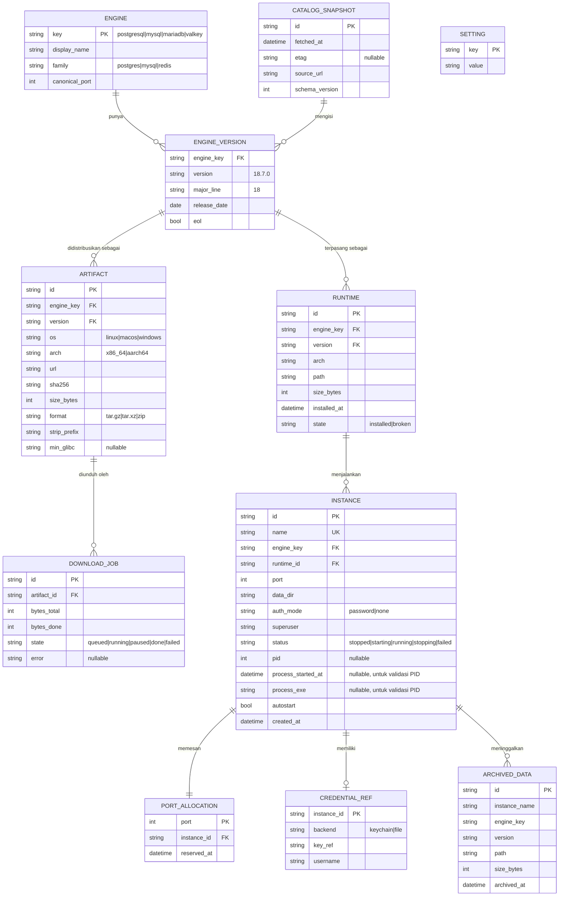
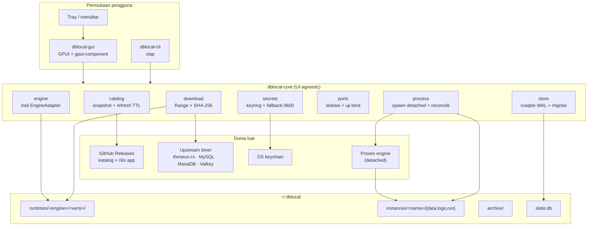

# PRD — DBLocal

Version: 0.1 · Status: Draft · Date: 2026-11-20 · Owner: rezkycodes

---

## 1. Summary

**DBLocal** adalah aplikasi desktop berbasis Rust yang memasang dan mengelola server database **di mesin lokal** developer: PostgreSQL, MySQL, MariaDB, dan Valkey (Redis-compatible). Targetnya adalah developer web yang memegang banyak project sekaligus dan hari ini terjebak antara dua pilihan buruk — memasang database lewat package manager OS (tidak bisa banyak versi berdampingan, butuh sudo, konflik port) atau menjalankan `docker compose` per project (berat di RAM/baterai, butuh YAML dan terminal).

Core value-nya satu: **beberapa versi engine hidup berdampingan sebagai proses native, dinyalakan dan dimatikan dengan satu klik, tanpa container dan tanpa terminal.**

Aplikasi ini gratis dan open source di bawah **GPL-3.0-only**, tanpa telemetri, tanpa akun, dan tidak pernah meminta sudo saat runtime. Ia **tidak mendistribusikan biner engine**; ia mengunduhnya dari sumber upstream, memverifikasi SHA-256-nya, dan menjalankannya sebagai proses milik user di bawah `~/.dblocal/`.

Phase 1 memuat irisan vertikal yang utuh dan benar-benar bisa dipakai: katalog versi → unduh & verifikasi → buat instance PostgreSQL atau Valkey → jalan di port yang dijamin bebas → salin connection URI → kelola lewat tray, lengkap dengan log viewer untuk jalur kegagalan, dan artefak install (AppImage, .tar.gz, .dmg ter-notarisasi, .zip, plus `install.sh` untuk `curl`).

DBLocal mengelola **server**, bukan **data**. Menjelajah tabel dan menjalankan query adalah non-goal permanen — itu pekerjaan DBDelve, TablePlus, atau DBeaver, dan DBLocal justru menyediakan tombol untuk membukanya di sana.

---

## 2. Problem & Jobs-to-be-Done

### Situasi hari ini

Pengguna utama: **developer web/full-stack (Laravel, Node/Next, Rails, Python) yang aktif memegang 3–10 project lokal sekaligus**, di Windows, macOS, maupun Linux.

Yang mereka lakukan sekarang, dan apa yang gagal:

| Cara sekarang | Yang gagal |
|---|---|
| `dnf install postgresql-server` / `brew install mysql` / installer EDB | Satu versi mayor per mesin. Project lama butuh PG 14, project baru butuh PG 18 → salah satu harus mengalah. Butuh sudo, service sistem selalu menyala, uninstall meninggalkan jejak. |
| `docker compose up` per project | Docker Desktop memakan RAM dan baterai bahkan saat idle; butuh file YAML yang dirawat; layer abstraksi tambahan saat debugging; di Windows butuh WSL2. |
| XAMPP / Laragon | Terikat satu stack dan satu versi; Windows-only; menjalankan service sistem sebagai administrator. |
| DBngin | Persis menyelesaikan masalah ini — tapi tidak ada untuk Linux, dan tidak punya CLI. |

### Primary job (sesi pertama)

> "Saya buka aplikasi, pilih PostgreSQL 18, klik Create, dan dalam waktu di bawah 2 menit saya punya server yang berjalan beserta connection string yang bisa saya tempel ke `.env` project saya — tanpa membuka terminal sekali pun."

### Core value (satu, bukan tiga)

**Multi-versi native, satu klik, tanpa container.**
Atribut pendukung (bukan janji utama): lintas-OS, ringan, satu panel untuk semua engine.

### Retention trigger

Ikon **tray/menubar permanen** dengan start/stop per instance tanpa membuka jendela, ditambah **autostart saat login**. Retensi datang dari utilitas harian: DBLocal menjadi bagian dari ritual "mulai kerja", bukan dari konten baru.

---

## 3. Goals, Metrics & Non-goals

Karena DBLocal **tidak punya telemetri** (D-05), tidak ada metrik yang mengandalkan pelaporan dari mesin user. Metrik produk diukur sebagai **test terotomasi di CI** pada runner tiap OS; metrik adopsi memakai **proksi publik**.

| Goal | Metrik | Target | Cara verifikasi |
|---|---|---|---|
| Sesi pertama berhasil, cepat | TTFRI (time-to-first-running-instance), PostgreSQL | p50 < 120 s @ 20 Mbps | E2E test di CI, bandwidth di-throttle |
| Sesi pertama berhasil, engine besar | TTFRI MySQL (artefak ±260 MB) | p50 < 300 s @ 20 Mbps | E2E test di CI |
| Terasa native, bukan web | Cold start app sampai window interaktif | p95 < 1,5 s | Benchmark CI (NVMe, runner standar) |
| Lebih ringan dari Docker | RSS aplikasi saat idle (tanpa instance jalan) | < 150 MB | Benchmark CI |
| Mudah dipasang | Ukuran installer per platform | < 60 MB | Gate ukuran artefak di CI |
| Jalan di semua target | Instalasi engine sukses di matrix OS | 100% (5 target) | Job E2E per OS tiap rilis |
| Start cepat | PostgreSQL stopped → menerima koneksi | p95 < 5 s | E2E |
| Start cepat | Valkey stopped → menerima koneksi | p95 < 1 s | E2E |
| Adopsi | Unduhan per rilis (GitHub Releases API) | tren naik antar rilis minor | Publik |
| Kualitas rilis | Rasio issue berlabel `install-failure` ÷ unduhan rilis | < 2% | Publik, dihitung manual per rilis |

### Non-goals

- **Browsing/query data di dalam app** (grid tabel, editor SQL, export CSV). Permanen di luar scope — DBLocal menyediakan tombol "Open in…" ke DBDelve/TablePlus/DBeaver/psql.
- **Mode server/headless.** DBLocal adalah tool mesin developer, bukan manajer service produksi. Tidak ada systemd system unit, tidak ada Windows Service, tidak pernah minta sudo saat runtime.
- **Auto-restart saat engine crash** (v1). Konsekuensi langsung dari arsitektur tanpa daemon supervisor (D-10). Crash ditampilkan sebagai status `failed` + log, bukan dihidupkan ulang diam-diam.
- **Upgrade versi mayor dengan migrasi data** (`pg_upgrade`, `mysql_upgrade`). Pindah dari PG 17 ke 18 artinya membuat instance baru dan memindahkan data sendiri (dump/restore manual di luar app).
- **Backup/restore terjadwal** dan **project profile/grup instance** — masuk Backlog, dievaluasi dari issue pengguna nyata.
- **Mengadopsi instalasi database yang sudah ada di mesin** (service systemd/brew/EDB). Deteksi lintas-OS terlalu rapuh dan berisiko merusak setup kerja user.
- **Manajemen user/akun di aplikasi.** Single-machine, single-user; tidak ada login, tidak ada sinkronisasi cloud.
- **Dukungan arsitektur di luar x86_64 dan aarch64** (ppc64le, i386, riscv).

---

## 4. Actors & Role Matrix

Tidak ada sistem autentikasi: DBLocal berjalan sebagai proses milik user OS yang sedang login, dan otoritasnya adalah izin filesystem OS itu sendiri.

| Aktor | Siapa | Masuk sejak |
|---|---|---|
| **User-GUI** | Manusia yang memakai jendela DBLocal / menu tray | Phase 1 |
| **User-CLI** | Manusia atau script (npm script, Makefile, CI lokal) lewat binary `dblocal` | Phase 2 |
| **OS-Autostart** | Login item OS (systemd --user, LaunchAgent, Registry Run) yang menjalankan DBLocal dalam mode tray | Phase 3 |
| **Engine process** | Proses database lepas (detached) yang dikendalikan, bukan dimiliki, oleh app | Phase 1 |

| Kapabilitas | User-GUI | User-CLI | OS-Autostart | Engine process |
|---|---|---|---|---|
| Lihat katalog versi | ✅ | ✅ (P2) | — | — |
| Unduh & pasang runtime engine | ✅ | ✅ (P2) | — | — |
| Buat / hapus instance | ✅ | ✅ (P2) | — | — |
| Start / stop instance | ✅ | ✅ (P2) | ✅ (P3, hanya instance ber-flag autostart) | — |
| Lihat & salin kredensial | ✅ | ✅ (P2, `uri`) | — | — |
| Baca log instance | ✅ | ✅ (P2) | — | menulis |
| Buat database & user di dalam instance | ✅ (P2) | ❌ | — | — |
| Ubah konfigurasi engine | ✅ (P3) | ❌ | — | membaca |
| Mengubah state di luar `~/.dblocal` | ❌ | ❌ | ❌ | ❌ |
| Meminta sudo / elevasi | ❌ (tidak pernah, by design) | ❌ | ❌ | ❌ |

---

## 5. Feature Map

```mermaid
graph TD
  ROOT[DBLocal]

  ROOT --> P0[Phase 0 · Spikes]
  P0 --> SPK[F-SPK Spikes &amp; Fondasi]

  ROOT --> P1[Phase 1 · MVP vertical slice]
  P1 --> CAT[F-CAT Engine Catalog]
  P1 --> RTM[F-RTM Runtime Installer]
  P1 --> PRT[F-PRT Port Manager]
  P1 --> INS[F-INS Instance Lifecycle]
  P1 --> CRD[F-CRD Credentials &amp; Connection]
  P1 --> LOG[F-LOG Logs &amp; Diagnostics]
  P1 --> TRY[F-TRY Tray &amp; Window]
  P1 --> PKG[F-PKG Packaging &amp; Install]

  ROOT --> P2[Phase 2 · Keluarga MySQL, CLI, paket lengkap]
  P2 --> ENG[F-ENG MySQL &amp; MariaDB]
  P2 --> DBU[F-DBU Database &amp; User Mgmt]
  P2 --> OPN[F-OPN Open in External Client]
  P2 --> CLI[F-CLI Command Line Interface]

  ROOT --> P3[Phase 3 · Konfigurasi &amp; polish]
  P3 --> CFG[F-CFG Config Editor]
  P3 --> AUT[F-AUT Autostart]
  P3 --> PLH[F-PLH Polish &amp; Accessibility]
```



| ID | Fitur | Phase | Prioritas | Role | Depends on |
|---|---|---|---|---|---|
| F-SPK | Spikes & fondasi workspace | 0 | must | — | — |
| F-CAT | Engine Catalog | 1 | must | User-GUI | F-SPK |
| F-RTM | Runtime Installer | 1 | must | User-GUI | F-CAT |
| F-PRT | Port Manager | 1 | must | User-GUI | F-SPK |
| F-INS | Instance Lifecycle | 1 | must | User-GUI | F-RTM, F-PRT |
| F-CRD | Credentials & Connection | 1 | must | User-GUI | F-INS |
| F-LOG | Logs & Diagnostics | 1 | must | User-GUI | F-INS |
| F-TRY | Tray & Window | 1 | must | User-GUI | F-INS |
| F-PKG | Packaging & Install | 1 | must | — | F-SPK |
| F-ENG | MySQL & MariaDB engines | 2 | must | User-GUI | F-INS |
| F-DBU | Database & User Management | 2 | must | User-GUI | F-INS, F-CRD |
| F-OPN | Open in External Client | 2 | should | User-GUI | F-CRD |
| F-CLI | Command Line Interface | 2 | should | User-CLI | F-INS |
| F-CFG | Config Editor | 3 | should | User-GUI | F-INS |
| F-AUT | Autostart | 3 | should | OS-Autostart | F-TRY, F-INS |
| F-PLH | Polish & Accessibility | 3 | should | User-GUI | F-TRY |

---

## 6. Feature Specifications

### F-SPK — Spikes & Fondasi (Phase 0)

- **Goal:** membayar risiko teknis terbesar di depan, sebelum ada kode produk yang mahal untuk dibuang.
- **Roles:** —
- **Sub-features:**

  **F-SPK-01 — GPUI berjalan di tiga OS**
  - AC1: Given runner CI Linux dengan driver Vulkan, When binary spike dijalankan, Then jendela GPUI terbuka dan merender daftar + tombol dari `gpui-component`, lalu keluar dengan kode 0.
  - AC2: Given mesin Linux **tanpa** Vulkan, When binary dijalankan, Then aplikasi keluar dengan pesan yang bisa ditindaklanjuti (menyebut paket driver yang dibutuhkan + link dokumentasi), **bukan** panic atau layar hitam.
  - AC3: Given Windows 11 x86_64 dan macOS 14+ (arm64), When binary dijalankan, Then jendela terbuka dan merender komponen yang sama.
  - Entities: — · Output: `docs/spikes/gpui-platform.md`

  **F-SPK-02 — Build Valkey untuk Windows & macOS**
  - AC1: Given source Valkey 8.x/9.x, When job CI menjalankan build CMake di `windows-latest`, Then dihasilkan `valkey-server.exe` yang bisa start, melayani `PING` → `PONG`, dan shutdown bersih.
  - AC2: Given runner `macos-latest` (arm64) dan `macos-13` (x86_64), When build dijalankan, Then dihasilkan biner untuk kedua arsitektur dengan hasil uji `PING` yang sama.
  - AC3: Given salah satu target gagal setelah upaya yang wajar, Then keputusan fallback D-13 diaktifkan: Valkey ditandai `unsupported` untuk platform itu di katalog, UI menampilkan alasan + saran, dan PRD ini diperbarui.
  - Entities: — · Output: `docs/spikes/valkey-build.md`

  **F-SPK-03 — Siklus hidup PostgreSQL dari tarball upstream**
  - AC1: Given artefak `theseus-rs/postgresql-binaries` 18.x untuk platform runner, When spike mengunduh, memverifikasi SHA-256, mengekstrak, menjalankan `initdb`, lalu `pg_ctl start`, Then koneksi TCP ke `127.0.0.1:<port>` berhasil melakukan `SELECT 1`.
  - AC2: Given siklus di AC1 selesai, When `pg_ctl stop -m fast` dipanggil, Then proses berakhir < 5 detik dan tidak ada proses postgres yatim yang tersisa.
  - Entities: — · Output: `docs/spikes/postgres-lifecycle.md`

  **F-SPK-04 — Tray icon di tiga OS bersama GPUI**
  - AC1: Given GPUI memiliki event loop-nya sendiri, When ikon tray dipasang (crate pihak ketiga atau API platform langsung), Then ikon muncul di Windows, macOS, dan setidaknya satu desktop environment Linux (GNOME via ekstensi AppIndicator, dan KDE).
  - AC2: Given menu tray diklik, Then aksi sampai ke state aplikasi tanpa memblokir atau merusak event loop GPUI.
  - AC3: Given tray tidak tersedia di lingkungan desktop user, Then aplikasi tetap berfungsi penuh lewat jendela, dan ketiadaan tray ditampilkan sebagai catatan, bukan error.
  - Entities: — · Output: `docs/spikes/tray-icon.md`
  - Catatan risiko: GPUI tidak dirancang dengan tray sebagai warga kelas satu; ini spike dengan ketidakpastian tertinggi kedua setelah F-SPK-02, dan retention trigger (D-04) bergantung padanya.

  **F-SPK-05 — Skeleton workspace & CI matrix**
  - AC1: Given repo kosong, When `cargo xtask ci` dijalankan lokal, Then workspace (`core`, `gui`, `cli`, `xtask`) terkompilasi, clippy bersih, dan test lulus.
  - AC2: Given push ke `main`, When workflow berjalan, Then matrix `linux-x86_64`, `linux-aarch64`, `macos-universal`, `windows-x86_64` semuanya menghasilkan artefak dan `checksums.txt`.
  - Entities: —

- **Definition of done Phase 0:** kelima spike menghasilkan jawaban YA/TIDAK yang terdokumentasi. Jika F-SPK-02 gagal, fallback D-13 dijalankan **sebelum** Phase 1 dimulai.

---

### F-CAT — Engine Catalog (Phase 1)

- **Goal:** menjadi satu-satunya sumber kebenaran tentang "versi apa yang ada, untuk platform apa, dari URL mana, dengan checksum apa" — tanpa scraping HTML saat runtime.
- **Roles:** User-GUI (baca), job CI (tulis).
- **Business rules:**
  - Katalog adalah file JSON ber-skema versi (`schema_version`), dibundel di dalam app saat rilis **dan** di-refresh dari GitHub raw.
  - Setiap entri artefak **wajib** punya `sha256`, `size_bytes`, dan `url`. Entri tanpa checksum tidak pernah ditampilkan sebagai bisa dipasang.
  - Katalog hanya mendaftar versi yang **didukung upstream**; versi EOL ditandai `eol: true` dan disembunyikan di balik toggle "Tampilkan versi lama".
- **Sub-features:**

  **F-CAT-01 — Snapshot bundled + refresh berkala**
  - AC1: Given app pertama kali dibuka tanpa koneksi internet, When halaman katalog dibuka, Then daftar versi dari snapshot bundled tetap tampil, disertai banner "Katalog mungkin tidak terbaru".
  - AC2: Given snapshot terakhir di-refresh lebih dari 24 jam lalu dan ada koneksi, When app dibuka, Then refresh berjalan di background dan UI diperbarui tanpa memblokir interaksi.
  - AC3: Given refresh gagal (timeout, 404, atau rate limit GitHub), Then kegagalan tidak menampilkan dialog error; hanya banner status katalog yang berubah, dan snapshot lama tetap dipakai.
  - AC4: Given payload katalog punya `schema_version` yang lebih tinggi dari yang dipahami app, Then app menolak payload tersebut, tetap memakai snapshot bundled, dan menyarankan update aplikasi.
  - Entities: CatalogSnapshot, EngineVersion, Artifact

  **F-CAT-02 — Daftar & filter versi**
  - AC1: Given katalog termuat, When user membuka "New Instance", Then hanya versi yang punya artefak untuk OS+arch mesin ini yang ditampilkan.
  - AC2: Given sebuah engine tidak punya artefak sama sekali untuk platform ini (mis. Valkey di Windows bila F-SPK-02 gagal), Then engine itu tetap terlihat tapi dinonaktifkan dengan alasan tekstual, bukan disembunyikan diam-diam.
  - AC3: Given sebuah versi sudah terpasang sebagai runtime lokal, Then versi itu ditandai "Terpasang" dan pembuatan instance darinya melewati seluruh langkah unduh.
  - Entities: EngineVersion, Artifact, Runtime

  **F-CAT-03 — Pipeline pembangun katalog (CI)**
  - AC1: Given job terjadwal harian, When job berjalan, Then ia menanyakan sumber upstream tiap engine (GitHub Releases untuk PostgreSQL, `downloads.mariadb.org/rest-api` untuk MariaDB, endpoint unduhan resmi MySQL, `download.valkey.io` untuk Valkey) dan menghasilkan `catalog/engines.json`.
  - AC2: Given sebuah artefak baru ditemukan, When job memproses, Then ia mengunduh file `.sha256` upstream bila ada, atau menghitung checksum sendiri, dan menolak menulis entri tanpa checksum.
  - AC3: Given hasil berbeda dari katalog saat ini, Then job membuka pull request (bukan push langsung) agar perubahan katalog selalu bisa ditinjau manusia.
  - Entities: EngineVersion, Artifact

- **Edge cases:** rate limit GitHub API (gunakan `If-None-Match`/ETag dan autentikasi token di CI) · upstream mengubah pola URL (job gagal keras dan memberi notifikasi, katalog lama tetap sah) · jam sistem user salah sehingga TTL tidak pernah kedaluwarsa (TTL dihitung dengan `max(0, now - fetched_at)`; nilai negatif dianggap kedaluwarsa).

---

### F-RTM — Runtime Installer (Phase 1)

- **Goal:** mengubah entri katalog menjadi direktori biner yang siap pakai di `~/.dblocal/runtimes/<engine>/<version>/`, dengan integritas yang terbukti.
- **Roles:** User-GUI
- **Business rules:**
  - Verifikasi SHA-256 **wajib** dan dilakukan sebelum ekstraksi. Tidak ada opsi "lewati verifikasi".
  - Unduhan ditulis ke file sementara `*.part` di direktori yang sama dengan tujuan akhir (agar `rename` bersifat atomik, satu filesystem).
  - Satu runtime dipakai bersama oleh banyak instance; runtime tidak pernah dihapus otomatis.
- **Sub-features:**

  **F-RTM-01 — Unduhan resumable dengan progres**
  - AC1: Given unduhan 260 MB sedang berjalan, When koneksi putus lalu user menekan "Lanjutkan", Then unduhan dilanjutkan dengan header HTTP `Range` dari byte terakhir, bukan diulang dari nol.
  - AC2: Given unduhan sedang berjalan, Then UI menampilkan persen, byte terunduh/total, kecepatan, dan ETA, serta diperbarui minimal 2×/detik.
  - AC3: Given server tidak mendukung `Range` (merespons 200 dan bukan 206), Then app mengulang dari awal secara transparan tanpa menampilkan error.
  - AC4: Given user menekan "Batal", Then unduhan berhenti < 1 detik dan file `.part` dihapus.
  - Entities: DownloadJob, Artifact

  **F-RTM-02 — Verifikasi & kegagalan yang bersih**
  - AC1: Given unduhan selesai, When SHA-256 yang dihitung tidak sama dengan nilai katalog, Then file dihapus, instalasi dibatalkan, dan pesan menyebut checksum yang diharapkan vs yang didapat beserta tombol "Coba lagi".
  - AC2: Given ekstraksi gagal di tengah (disk penuh, arsip korup), Then direktori runtime yang setengah jadi dihapus seluruhnya sehingga tidak pernah ada runtime dalam keadaan setengah terpasang.
  - AC3: Given arsip berisi path yang keluar dari direktori tujuan (`../`) atau symlink absolut, Then ekstraksi ditolak sebagai arsip tidak aman (proteksi zip-slip).
  - Entities: Runtime, DownloadJob

  **F-RTM-03 — Ekstraksi & layout runtime**
  - AC1: Given arsip `.tar.gz`, `.tar.xz`, atau `.zip`, When diekstrak, Then isinya mendarat di `~/.dblocal/runtimes/<engine>/<version>-<arch>/` dengan `strip_prefix` dari katalog diterapkan sehingga `bin/` berada tepat satu tingkat di dalamnya.
  - AC2: Given platform Unix, When ekstraksi selesai, Then bit executable pada file di `bin/` dipastikan menyala.
  - AC3: Given runtime sudah ada untuk versi+arch yang sama, Then unduhan dilewati dan status langsung `installed`.
  - Entities: Runtime

  **F-RTM-04 — Reclaim disk**
  - AC1: Given sebuah runtime tidak lagi dirujuk instance mana pun, When user membuka Settings → Storage, Then runtime itu terdaftar sebagai "Tidak terpakai" beserta ukurannya dan bisa dihapus.
  - AC2: Given runtime masih dirujuk minimal satu instance, Then tombol hapusnya nonaktif dengan daftar instance yang memakainya.
  - Entities: Runtime, Instance

- **Edge cases:** disk tidak cukup (cek ruang bebas ≥ `size_bytes × 3` sebelum mulai, bukan saat gagal) · antivirus Windows mengunci file saat ekstraksi (retry dengan backoff, lalu pesan yang menyebut antivirus) · path panjang > 260 karakter di Windows (gunakan path `\\?\` verbatim).

---

### F-PRT — Port Manager (Phase 1)

- **Goal:** menjamin instance baru tidak pernah gagal start karena port, dan membuat `.env` project yang sudah ada tetap jalan tanpa diubah.
- **Roles:** User-GUI
- **Business rules:**
  - Port kanonik per engine: PostgreSQL 5432, MySQL 3306, MariaDB 3307, Valkey 6379.
  - Instance pertama suatu engine mendapat port kanonik; berikutnya naik ke port bebas berikutnya.
  - Kepemilikan port dicatat di tabel dengan **unique constraint**, dan selalu diverifikasi ulang dengan uji bind nyata sebelum start.
- **Sub-features:**

  **F-PRT-01 — Alokasi otomatis**
  - AC1: Given belum ada instance PostgreSQL, When user membuat instance PostgreSQL, Then port yang diusulkan adalah 5432.
  - AC2: Given sudah ada instance di 5432, When user membuat instance PostgreSQL kedua, Then port yang diusulkan adalah 5433 (port bebas berikutnya, melompati yang sudah dialokasikan di dalam app).
  - AC3: Given user mengetik port manual yang sudah dialokasikan instance DBLocal lain, Then form menolak submit dengan menyebut nama instance pemiliknya.
  - Entities: PortAllocation, Instance

  **F-PRT-02 — Uji bind sebelum start**
  - AC1: Given port instance ditempati proses di luar DBLocal (mis. PostgreSQL bawaan sistem atau container), When user menekan Start, Then app mendeteksinya lewat percobaan bind nyata ke `127.0.0.1:<port>` **sebelum** menjalankan engine, dan menampilkan dialog "Port 5432 sedang dipakai" dengan aksi 1-klik "Pindah ke 5433".
  - AC2: Given user memilih pindah port, Then konfigurasi instance diperbarui, alokasi port lama dilepas, dan start dilanjutkan tanpa langkah tambahan.
  - AC3: Given uji bind berhasil, Then socket uji ditutup sebelum engine dijalankan sehingga tidak ada balapan dengan proses engine itu sendiri.
  - Entities: PortAllocation, Instance

- **Edge cases:** port < 1024 diketik manual (ditolak dengan penjelasan "butuh privilese, DBLocal tidak pernah meminta sudo") · `SO_REUSEADDR` membuat bind seolah berhasil padahal ada listener lain (uji bind memakai opsi default tanpa reuse, dan pada Windows memakai `SO_EXCLUSIVEADDRUSE`) · IPv6 `::1` ditempati sementara `127.0.0.1` bebas (uji kedua stack, laporkan jika salah satunya tidak bisa).

---

### F-INS — Instance Lifecycle (Phase 1)

- **Goal:** inti produk — membuat, menjalankan, menghentikan, dan menghapus instance database, serta tetap benar meskipun aplikasi ditutup di tengah jalan.
- **Roles:** User-GUI
- **State machine:**



  Pemicu transisi: semua transisi dipicu **User-GUI** (atau User-CLI sejak Phase 2), kecuali `running → failed` yang dipicu **Engine process** yang mati, dan `starting → failed` oleh timeout health check.

- **Business rules:**
  - Nama instance unik, `^[a-z0-9][a-z0-9-]{1,30}$`, dipakai sebagai nama direktori data.
  - Data dir: `~/.dblocal/instances/<nama>/data`, log: `~/.dblocal/instances/<nama>/logs/`, pidfile: `~/.dblocal/instances/<nama>/run/`.
  - Engine di-spawn **detached** (`setsid` + `prctl`-free di Unix, `DETACHED_PROCESS | CREATE_NEW_PROCESS_GROUP` di Windows) sehingga tidak ikut mati saat app di-quit.
  - Health check adalah **koneksi protokol sungguhan** (PostgreSQL: `pg_isready`/handshake; Valkey: `PING`; MySQL/MariaDB: handshake), bukan sekadar "proses masih hidup".
  - Timeout start: 30 detik (PostgreSQL/MySQL/MariaDB), 10 detik (Valkey). Lewat itu → `failed` + log ditampilkan otomatis.
  - Stop memakai shutdown bersih engine lebih dulu (`pg_ctl stop -m fast`, `mysqladmin shutdown`, `SHUTDOWN NOSAVE`/SIGTERM); SIGKILL hanya setelah 20 detik dan dicatat di log sebagai kill paksa.
- **Sub-features:**

  **F-INS-01 — Buat instance**
  - AC1: Given user memilih engine + versi dan menekan Create, When runtime yang dibutuhkan sudah terpasang, Then instance tercipta dengan status `stopped` dalam < 10 detik tanpa pertanyaan tambahan selain nama (terisi default).
  - AC2: Given runtime belum terpasang, Then alur berlanjut otomatis ke F-RTM dengan progres yang terlihat, lalu kembali ke inisialisasi tanpa interaksi user.
  - AC3: Given nama instance sudah dipakai, Then form menolak dengan saran nama alternatif.
  - Entities: Instance, Runtime, PortAllocation, CredentialRef

  **F-INS-02 — Inisialisasi data directory**
  - AC1: Given instance PostgreSQL baru, When inisialisasi berjalan, Then `initdb` dipanggil dengan encoding UTF-8, locale `C.UTF-8` (atau padanan platform), dan metode autentikasi sesuai mode auth yang dipilih (`scram-sha-256` atau `trust`).
  - AC2: Given instance Valkey baru, Then sebuah `valkey.conf` dibuat berisi `bind 127.0.0.1`, `port <port>`, `dir <data_dir>`, dan `requirepass` bila mode auth berpassword.
  - AC3: Given inisialisasi gagal, Then direktori data dibersihkan seluruhnya dan output mentah dari tool engine ditampilkan di panel log, bukan diringkas menjadi "terjadi kesalahan".
  - AC4: Given platform mana pun, Then semua engine dikonfigurasi untuk **hanya** mendengarkan `127.0.0.1` (dan `::1`), tidak pernah `0.0.0.0`.
  - Entities: Instance, Runtime

  **F-INS-03 — Start / Stop**
  - AC1: Given instance `stopped`, When user menekan Start, Then uji bind F-PRT-02 berjalan, engine di-spawn detached, dan status berubah ke `running` setelah health check lulus.
  - AC2: Given instance `running` dan user menutup jendela app lalu keluar sepenuhnya, When app dibuka lagi, Then instance masih `running` dan masih bisa dikendalikan.
  - AC3: Given instance `running`, When user menekan Stop, Then shutdown bersih dipanggil dan status menjadi `stopped` dalam < 20 detik; bila lewat, kill paksa dijalankan dan dicatat.
  - AC4: Given proses engine mati sendiri, When app mendeteksinya (poll ≤ 2 detik), Then status menjadi `failed` dan 20 baris log terakhir ditampilkan tanpa diminta.
  - Entities: Instance, PortAllocation

  **F-INS-04 — Rekonsiliasi proses yatim**
  - AC1: Given app dijalankan dan ada pidfile dari sesi sebelumnya, When rekonsiliasi berjalan, Then setiap PID diverifikasi bukan hanya "ada", tapi **benar proses engine milik kita** dengan mencocokkan nama executable dan waktu mulai proses terhadap yang tercatat.
  - AC2: Given PID sudah dipakai ulang oleh proses lain yang tidak cocok, Then pidfile dianggap basi, dihapus, dan instance ditandai `stopped` — app tidak pernah mengirim sinyal ke proses asing.
  - AC3: Given rekonsiliasi untuk 20 instance, Then seluruhnya selesai < 2 detik dan tidak memblokir render jendela.
  - Entities: Instance

  **F-INS-05 — Hapus instance**
  - AC1: Given user menekan Delete, Then dialog menampilkan ukuran data dir saat ini dan dua aksi: "Hapus instance & data" dan "Hapus instance, simpan data".
  - AC2: Given user memilih "Hapus instance & data", Then tombol konfirmasi baru aktif setelah user mengetik nama instance dengan tepat.
  - AC3: Given user memilih "Hapus instance, simpan data", Then direktori data dipindahkan ke `~/.dblocal/archive/<nama>-<YYYYMMDD-HHMM>/`, entri instance dihapus, alokasi port dilepas, dan kredensial di keychain dihapus.
  - AC4: Given instance sedang `running`, Then Delete menghentikannya lebih dulu dan gagal bersih bila penghentian gagal.
  - Entities: Instance, ArchivedData, PortAllocation, CredentialRef

- **Edge cases:** data dir ada tapi tidak dikenali app (instance dibuat ulang dengan nama sama → tolak, minta nama lain atau pulihkan dari arsip) · jam sistem mundur sehingga perbandingan waktu mulai proses meleset (toleransi ±2 detik, jika ragu → anggap basi) · home directory di filesystem jaringan (peringatkan: engine butuh locking POSIX yang benar) · nama user OS mengandung spasi/karakter non-ASCII (path dikutip di semua pemanggilan proses; diuji di CI).

---

### F-CRD — Credentials & Connection (Phase 1)

- **Goal:** membuat langkah terakhir sesi pertama — "tempel ke `.env`" — menjadi satu klik, tanpa menyimpan password sembarangan.
- **Roles:** User-GUI
- **Business rules:**
  - Default: superuser bernama kanonik (`postgres`, `root`, `default` untuk Valkey) dengan password acak **24 karakter** dari CSPRNG.
  - Password disimpan di OS keychain (Secret Service/libsecret di Linux, Keychain di macOS, Credential Manager di Windows). Fallback bila keychain tidak tersedia: `~/.dblocal/secrets/<instance>.key` dengan mode `0600` — dan fakta fallback ini ditampilkan di UI.
  - **Password tidak pernah ditulis ke `state.db`, ke log, atau ke pesan error.**
  - Mode "tanpa password" hanya bisa dipilih saat create, ditandai permanen di UI instance, dan disertai peringatan yang menyebut risikonya.
- **Sub-features:**

  **F-CRD-01 — Generate & simpan kredensial**
  - AC1: Given instance baru dengan mode auth berpassword, When dibuat, Then password 24 karakter dihasilkan dari CSPRNG OS dan disimpan di keychain dengan kunci `dblocal:<instance-id>`.
  - AC2: Given keychain tidak tersedia (mis. Linux headless tanpa Secret Service), Then fallback file `0600` dipakai dan UI menampilkan catatan "Disimpan di file, bukan keychain" beserta path-nya.
  - AC3: Given instance dihapus, Then entri keychain/file-nya ikut terhapus.
  - Entities: CredentialRef, Instance

  **F-CRD-02 — Salin connection URI**
  - AC1: Given instance `running`, When user menekan "Copy URI", Then clipboard berisi URI lengkap dan valid, mis. `postgresql://postgres:<password>@127.0.0.1:5432/postgres`, dan toast konfirmasi muncul.
  - AC2: Given instance Valkey, Then URI berbentuk `redis://default:<password>@127.0.0.1:6379` (skema `redis://` dipakai karena itulah yang dipahami klien).
  - AC3: Given user menekan "Copy .env", Then clipboard berisi blok variabel lingkungan bergaya framework (`DB_CONNECTION`, `DB_HOST`, `DB_PORT`, `DB_DATABASE`, `DB_USERNAME`, `DB_PASSWORD`).
  - AC4: Given password berisi karakter yang perlu di-escape pada URI, Then password di-percent-encode dengan benar sehingga URI selalu bisa di-parse.
  - Entities: Instance, CredentialRef

  **F-CRD-03 — Mode tanpa password**
  - AC1: Given user mencentang "Izinkan koneksi tanpa password" saat create, Then dialog peringatan menjelaskan bahwa proses dan user lain di mesin ini bisa terhubung tanpa kredensial, dan user harus mengonfirmasi sekali lagi.
  - AC2: Given mode ini aktif, Then kartu instance menampilkan badge "No auth" permanen.
  - AC3: Given engine Valkey dengan mode ini, Then `protected-mode yes` tetap dipertahankan di config sebagai lapisan pertahanan terakhir.
  - Entities: Instance

- **Edge cases:** keychain terkunci saat app jalan (minta unlock lewat API OS; jika gagal, tampilkan instruksi dan jangan crash) · user menyalin URI saat instance `stopped` (URI tetap diberikan, dengan catatan bahwa instance belum jalan).

---

### F-LOG — Logs & Diagnostics (Phase 1)

- **Goal:** saat sesuatu gagal, user harus bisa melihat sebabnya tanpa membuka terminal. Ini jalur kegagalan dari core value, jadi ia wajib ada di Phase 1.
- **Roles:** User-GUI
- **Sub-features:**

  **F-LOG-01 — Panel log per instance**
  - AC1: Given instance pernah dijalankan, When user membuka tab Logs, Then 1.000 baris terakhir tampil dan log baru mengalir secara live selama instance `running`.
  - AC2: Given file log melebihi 10 MB, Then log dirotasi (`.1`, `.2`, maksimal 3 berkas) sehingga disk tidak tumbuh tanpa batas.
  - AC3: Given user menekan "Salin log", Then 500 baris terakhir masuk clipboard untuk ditempel ke issue GitHub.
  - Entities: Instance

  **F-LOG-02 — Diagnosa gagal start**
  - AC1: Given start gagal, When app menampilkan kegagalan, Then pesannya memetakan penyebab yang dikenal menjadi aksi: port dipakai → "Pindah port"; data dir dibuat oleh versi engine berbeda → "Versi tidak cocok, butuh instance baru"; izin ditolak → path yang bermasalah; biner hilang/korup → "Pasang ulang runtime".
  - AC2: Given penyebab tidak dikenali, Then app menampilkan baris log mentah terakhir yang relevan + tombol "Laporkan issue" yang membuka GitHub dengan template terisi (OS, arsitektur, versi app, engine, versi engine) — **tanpa** menyertakan password atau path home yang teridentifikasi.
  - Entities: Instance

---

### F-TRY — Tray & Window (Phase 1)

- **Goal:** mewujudkan retention trigger (D-04): mengendalikan database tanpa membuka jendela.
- **Roles:** User-GUI
- **Sub-features:**

  **F-TRY-01 — Menu tray**
  - AC1: Given app berjalan, Then ikon tray/menubar menampilkan daftar instance beserta titik status (hijau `running`, abu `stopped`, merah `failed`) dan memungkinkan start/stop langsung dari menu.
  - AC2: Given sebuah instance diubah dari menu tray, Then jendela utama (bila terbuka) mencerminkan perubahan itu dalam ≤ 1 detik.
  - AC3: Given tray tidak didukung lingkungan desktop user, Then app tetap berfungsi penuh lewat jendela dan menampilkan catatan sekali saja.
  - Entities: Instance

  **F-TRY-02 — Perilaku close & quit**
  - AC1: Given user menutup jendela, Then app tetap hidup di tray dan instance tetap berjalan.
  - AC2: Given user memilih Quit, When masih ada instance `running`, Then dialog menawarkan "Biarkan tetap berjalan" (default) atau "Hentikan semua lalu keluar".
  - AC3: Given user memilih "Biarkan tetap berjalan", Then proses engine tetap hidup setelah app berhenti, dan saat app dibuka lagi F-INS-04 menyambungkannya kembali.
  - Entities: Instance

---

### F-PKG — Packaging & Install (Phase 1 → Phase 2)

- **Goal:** memenuhi permintaan distribusi: `.rpm`, `.deb`, `.AppImage`, `.zip`, `.dmg`, dan instalasi lewat `curl`.
- **Roles:** —
- **Business rules:**
  - Semua artefak dibangun di GitHub Actions dari tag; tidak ada build manual dari mesin pengembang.
  - Setiap rilis menyertakan `checksums.txt` dan attestation/provenance bawaan GitHub.
  - macOS **wajib** ditandatangani Developer ID + notarisasi. Windows dirilis tanpa tanda tangan di v1, disertai dokumentasi SmartScreen.
- **Sub-features:**

  **F-PKG-01 — Matrix build & checksum (P1)**
  - AC1: Given sebuah tag `v*` didorong, Then CI menghasilkan artefak untuk `linux-x86_64`, `linux-aarch64`, `macos-universal`, `windows-x86_64` beserta `checksums.txt`.
  - AC2: Given artefak melebihi batas ukuran 60 MB, Then build gagal (gate ukuran), bukan lolos diam-diam.

  **F-PKG-02 — Artefak portabel (P1)**
  - AC1: Given rilis Phase 1, Then tersedia `.AppImage` dan `.tar.gz` (Linux), `.dmg` ter-notarisasi (macOS universal), dan `.zip` (Windows).
  - AC2: Given AppImage dijalankan di Fedora dan Ubuntu LTS terbaru, Then app terbuka tanpa dependensi tambahan selain driver Vulkan sistem.
  - AC3: Given `.dmg` diunduh lewat browser di macOS, Then app terbuka tanpa perlu perintah terminal apa pun (bukti notarisasi berhasil).

  **F-PKG-03 — install.sh untuk curl (P1)**
  - AC1: Given `curl -fsSL https://dblocal.dev/install.sh | sh` (atau URL raw GitHub) dijalankan di Linux atau macOS, Then skrip mendeteksi OS+arch, mengunduh artefak yang tepat, memverifikasi checksum, memasang ke `~/.local/bin` (atau `/usr/local/bin` bila dapat ditulis), dan mencetak langkah berikutnya.
  - AC2: Given arsitektur tidak didukung, Then skrip berhenti dengan pesan jelas dan **tidak** memasang apa pun.
  - AC3: Given skrip dijalankan ulang, Then ia melakukan upgrade in-place secara idempoten.
  - AC4: Skrip lulus `shellcheck` di CI dan tidak pernah memanggil `sudo` tanpa diminta eksplisit lewat flag.

  **F-PKG-04 — Paket native (P2)**
  - AC1: Given rilis Phase 2, Then tersedia `.deb` (Debian/Ubuntu), `.rpm` (Fedora/RHEL), dan `.msi` (Windows).
  - AC2: Given `.deb`/`.rpm` dipasang lalu dihapus, Then tidak ada berkas tertinggal di luar `~/.dblocal` (data user sengaja dipertahankan dan fakta ini disebut saat uninstall).

  **F-PKG-05 — Self-update (P2)**
  - AC1: Given versi lebih baru tersedia di GitHub Releases, When user membuka Settings → Updates (atau pemeriksaan berkala), Then versi baru + catatan rilis ditampilkan dengan tombol pasang.
  - AC2: Given app dipasang lewat package manager OS (`.deb`/`.rpm`/Homebrew), Then self-update dinonaktifkan dan app mengarahkan user ke package manager-nya.
  - AC3: Given platform Windows, Then update memakai proses helper yang mengganti binary setelah app keluar, karena binary yang sedang berjalan tidak bisa ditimpa.
  - AC4: Given paket update, Then checksum diverifikasi sebelum dipasang.

---

### F-ENG — MySQL & MariaDB (Phase 2)

- **Goal:** memenuhi janji empat engine dengan memanfaatkan `EngineAdapter` yang sudah teruji oleh dua engine paling berbeda di Phase 1.
- **Roles:** User-GUI
- **Sub-features:**

  **F-ENG-01 — Adapter MySQL**
  - AC1: Given artefak MySQL dari katalog, When instance dibuat, Then inisialisasi memakai `mysqld --initialize-insecure`, lalu password superuser di-set dan `my.cnf` ditulis dengan `bind-address=127.0.0.1`, `port`, dan `datadir` instance.
  - AC2: Given instance `running`, Then health check memakai handshake protokol MySQL, bukan sekadar cek proses.
  - AC3: Given unduhan 260 MB, Then progres dan ETA ditampilkan sejak byte pertama dan unduhan dapat dilanjutkan setelah putus.

  **F-ENG-02 — Adapter MariaDB**
  - AC1: Given artefak MariaDB dari `downloads.mariadb.org/rest-api`, When instance dibuat, Then inisialisasi memakai `mariadb-install-db` dengan `--auth-root-authentication-method=normal`.
  - AC2: Given MariaDB dan MySQL sama-sama terpasang, Then keduanya tampil sebagai engine berbeda dengan port kanonik berbeda (3306 vs 3307) dan tidak pernah berbagi data dir.

- **Edge cases:** MySQL di macOS membutuhkan dylib yang di-path-kan relatif (atur `DYLD_LIBRARY_PATH` atau perbaiki rpath saat ekstraksi) · tarball MySQL untuk Linux ditautkan ke glibc tertentu (katalog mencatat `min_glibc`; versi yang tidak cocok disembunyikan untuk platform itu).

---

### F-DBU — Database & User Management (Phase 2)

- **Goal:** menutup satu-satunya alasan tersisa untuk membuka terminal: membuat database untuk project baru.
- **Roles:** User-GUI
- **Business rules:** semua perintah dijalankan lewat driver klien dengan **parameter/identifier quoting yang benar**, tidak pernah dengan menyambung string mentah. Nama database/user divalidasi terhadap allowlist karakter sebelum dikirim.
- **Sub-features:**

  **F-DBU-01 — Kelola database**
  - AC1: Given instance `running`, When user membuka tab Databases, Then daftar database beserta ukurannya tampil.
  - AC2: Given user membuat database baru dengan nama valid, Then database tercipta dengan encoding UTF-8 (`utf8mb4_unicode_ci` untuk keluarga MySQL) dan langsung muncul di daftar.
  - AC3: Given user menghapus database, Then konfirmasi mengharuskan pengetikan nama database.
  - AC4: Given nama mengandung karakter di luar `[A-Za-z0-9_]`, Then form menolaknya sebelum perintah apa pun dikirim ke engine.
  - Entities: Instance

  **F-DBU-02 — Kelola user & hak akses**
  - AC1: Given user membuat database user baru, Then ia dapat memilih database dan tingkat hak (read-only atau read-write), dan perintah GRANT yang sesuai dijalankan.
  - AC2: Given user dibuat, Then password-nya ditampilkan sekali dan disimpan di keychain seperti kredensial superuser.
  - Entities: Instance, CredentialRef

  **F-DBU-03 — Reset password superuser**
  - AC1: Given user menekan "Reset password", Then password baru dihasilkan, diterapkan ke engine, disimpan ke keychain, dan URI yang ditampilkan ikut diperbarui.
  - AC2: Given reset gagal di tengah, Then password lama tetap berlaku dan keychain tidak diubah.
  - Entities: Instance, CredentialRef

- **Catatan:** tab ini tidak pernah menampilkan isi tabel. Batas itu yang memisahkan DBLocal dari DB client.

---

### F-OPN — Open in External Client (Phase 2)

- **Goal:** menghubungkan non-goal "browsing data" ke tool yang memang untuk itu, dengan biaya implementasi mendekati nol.
- **Roles:** User-GUI
- **Sub-features:**

  **F-OPN-01 — Deteksi client terpasang**
  - AC1: Given mesin memiliki DBDelve, TablePlus, DBeaver, atau CLI (`psql`, `mysql`, `valkey-cli`/`redis-cli`), When user membuka menu "Open in…", Then hanya client yang benar-benar terdeteksi yang ditampilkan.
  - AC2: Given tidak ada satu pun terdeteksi, Then menu menampilkan "Salin URI" sebagai gantinya, bukan daftar kosong.
  - Entities: Instance

  **F-OPN-02 — Buka dengan koneksi instance**
  - AC1: Given user memilih sebuah client GUI, Then client terbuka langsung pada koneksi instance tersebut (URL scheme bila tersedia, mis. `tableplus://`, atau argumen baris perintah).
  - AC2: Given user memilih client CLI, Then terminal OS terbuka dengan perintah siap jalan, dan password diberikan lewat variabel lingkungan (`PGPASSWORD`, `MYSQL_PWD`) — **tidak** sebagai argumen yang terlihat di daftar proses.
  - Entities: Instance, CredentialRef

---

### F-CLI — Command Line Interface (Phase 2)

- **Goal:** membuat DBLocal bisa dipakai di `package.json`, `Makefile`, dan skrip onboarding tim.
- **Roles:** User-CLI
- **Business rules:** binary yang sama dengan GUI; tanpa argumen → membuka GUI, dengan subcommand → mode CLI. Semua perintah punya exit code bermakna (0 sukses, 1 error umum, 2 argumen salah, 3 instance tidak ditemukan, 4 engine gagal start).
- **Sub-features:**

  **F-CLI-01 — Inspeksi**
  - AC1: Given beberapa instance ada, When `dblocal list` dijalankan, Then tabel nama/engine/versi/port/status tercetak; `--json` menghasilkan JSON yang bisa dipipe.
  - AC2: Given `dblocal status <nama>`, Then status instance dicetak dengan exit code 0 bila `running`, dan non-nol bila tidak.

  **F-CLI-02 — Kontrol**
  - AC1: Given `dblocal start <nama>`, Then perintah memblokir sampai health check lulus atau timeout, lalu keluar dengan kode yang sesuai.
  - AC2: Given GUI sedang terbuka saat CLI mengubah state, Then GUI mencerminkan perubahan dalam ≤ 2 detik (polling state SQLite).
  - AC3: Given dua proses mencoba start instance yang sama bersamaan, Then satu menang dan yang lain keluar dengan pesan "sudah berjalan" — dijamin oleh transaksi SQLite, bukan oleh urutan waktu.

  **F-CLI-03 — Lifecycle & URI**
  - AC1: Given `dblocal uri <nama>`, Then connection URI tercetak ke stdout tanpa hiasan apa pun sehingga bisa langsung di-pipe ke `.env`.
  - AC2: Given `dblocal create --engine postgresql --version 18.7 --name app-dev`, Then instance dibuat non-interaktif, mengunduh runtime bila perlu, dan mencetak URI saat selesai.
  - AC3: Given `dblocal delete <nama>`, Then penghapusan menolak berjalan tanpa `--yes` di sesi non-interaktif, dan default-nya **mengarsipkan** data, bukan menghapusnya.

---

### F-CFG — Config Editor (Phase 3)

- **Goal:** menutup kebutuhan tuning yang sering muncul tanpa memaksa user mencari file konfigurasi.
- **Roles:** User-GUI
- **Sub-features:**

  **F-CFG-01 — Form setting penting**
  - AC1: Given instance PostgreSQL, When user membuka tab Config, Then form menampilkan subset bernilai tinggi (`port`, `max_connections`, `shared_buffers`, `work_mem`, `timezone`, metode autentikasi) beserta nilai saat ini dan nilai default.
  - AC2: Given user menyimpan perubahan, Then app memberi tahu bahwa restart diperlukan dan menawarkan melakukannya sekarang.
  - AC3: Given perubahan membuat engine gagal start, Then app menawarkan "Kembalikan konfigurasi sebelumnya" dari salinan yang disimpan sebelum perubahan.

  **F-CFG-02 — Edit berkas mentah**
  - AC1: Given user memilih "Buka file konfigurasi", Then file dibuka di editor teks default OS, dan komentar serta baris yang tidak dikenal app tidak pernah ditulis ulang atau dihapus oleh app.
  - Entities: Instance

---

### F-AUT — Autostart (Phase 3)

- **Goal:** menyempurnakan retention trigger: database yang dibutuhkan sudah siap sebelum user memintanya.
- **Roles:** OS-Autostart, User-GUI
- **Sub-features:**

  **F-AUT-01 — Autostart aplikasi saat login**
  - AC1: Given user mengaktifkan "Jalankan saat login", Then login item terdaftar lewat mekanisme user-level yang sesuai: systemd `--user` unit (Linux), LaunchAgent (macOS), Registry `Run` (Windows) — tanpa sudo.
  - AC2: Given opsi dimatikan, Then entri itu dihapus sepenuhnya.
  - AC3: Given app dijalankan oleh login item, Then ia terbuka langsung ke tray tanpa memunculkan jendela.

  **F-AUT-02 — Autostart instance terpilih**
  - AC1: Given sebuah instance ditandai autostart, When app dijalankan saat login, Then instance itu dinyalakan dan hasilnya (berhasil/gagal) terlihat di tray.
  - AC2: Given autostart sebuah instance gagal, Then kegagalan tidak memblokir instance lain dan tidak memunculkan dialog modal; status `failed` cukup ditampilkan di tray dan jendela.
  - Entities: Instance

---

### F-PLH — Polish & Accessibility (Phase 3)

- **Goal:** membuat app layak dipakai setiap hari oleh orang yang tidak memakai mouse, dan di kedua tema sistem.
- **Sub-features:**

  **F-PLH-01 — Navigasi keyboard penuh**
  - AC1: Given hanya keyboard, Then seluruh alur sesi pertama (pilih engine → create → start → copy URI) dapat diselesaikan, dengan fokus yang selalu terlihat.
  - AC2: Given command palette (`Ctrl/Cmd+K`), Then user dapat mencari instance dan menjalankan start/stop/copy URI.

  **F-PLH-02 — Tema & kontras**
  - AC1: Given tema sistem terang atau gelap, Then app mengikutinya, dan seluruh teks memenuhi rasio kontras minimal 4,5:1.
  - AC2: Given status instance, Then status tidak pernah disampaikan hanya lewat warna (selalu ada label teks atau ikon pendamping).

---

## 7. Data Model

Seluruh state aplikasi berada di satu berkas SQLite `~/.dblocal/state.db` (mode WAL). Katalog adalah data turunan yang di-cache, bukan sumber kebenaran.



| Entitas | Field kunci | Pemilik data (yang membuat/mengubah) | Lifecycle |
|---|---|---|---|
| Engine | `key`, `canonical_port` | Konstanta di dalam app | Statik, berubah hanya lewat rilis app |
| EngineVersion | `engine_key`+`version` | Job CI katalog (F-CAT-03) | Di-refresh dari katalog; entri lama disimpan bila masih dipakai runtime |
| Artifact | `sha256`, `url` | Job CI katalog | Sama dengan EngineVersion |
| Runtime | `path`, `state` | F-RTM | Hard delete lewat F-RTM-04, hanya bila tidak dirujuk |
| Instance | `name`, `port`, `status` | F-INS | Hard delete, dengan opsi mengarsipkan data dir |
| PortAllocation | `port` (unik) | F-PRT | Dilepas saat instance dihapus atau port diubah |
| CredentialRef | `key_ref` | F-CRD | Dihapus bersama instance; rahasianya ada di keychain, bukan di DB |
| DownloadJob | `bytes_done`, `state` | F-RTM | Dibersihkan 7 hari setelah selesai |
| ArchivedData | `path`, `size_bytes` | F-INS-05 | Hanya dihapus manual lewat Settings → Storage |
| CatalogSnapshot | `fetched_at`, `etag` | F-CAT-01 | Hanya satu baris aktif; diganti saat refresh |

### Data pribadi & retensi

DBLocal **tidak mengumpulkan data pribadi** dan tidak mengirim apa pun ke server mana pun selain: (a) permintaan HTTP ke sumber unduhan engine dan katalog, (b) pemeriksaan versi ke GitHub Releases API. Tidak ada identifier, tidak ada data usage. Seluruh state tetap di mesin user. Password berada di keychain OS, bukan di `state.db`. Karena itu tidak ada kewajiban pemrosesan data pribadi menurut GDPR/UU PDP yang timbul dari aplikasi ini — dan fakta ini ditegaskan di README serta halaman Settings → Privacy.

---

## 8. Command Surface

Tidak ada API jaringan — DBLocal tidak punya server. Permukaan publiknya adalah **core API** (dipakai GUI dan CLI) dan **CLI**.

### Core API (crate `dblocal-core`)

| Operasi | Masuk sejak | Sub-fitur |
|---|---|---|
| `catalog.refresh(force: bool)` | P1 | F-CAT-01 |
| `catalog.list_versions(engine, os, arch)` | P1 | F-CAT-02 |
| `runtime.install(engine, version) -> DownloadJob` | P1 | F-RTM-01..03 |
| `runtime.remove(runtime_id)` | P1 | F-RTM-04 |
| `ports.allocate(engine) -> u16` | P1 | F-PRT-01 |
| `ports.probe(port) -> BindResult` | P1 | F-PRT-02 |
| `instance.create(spec) -> Instance` | P1 | F-INS-01..02 |
| `instance.start(id)` / `instance.stop(id)` | P1 | F-INS-03 |
| `instance.reconcile_all()` | P1 | F-INS-04 |
| `instance.delete(id, DeleteMode)` | P1 | F-INS-05 |
| `creds.uri(id, UriFormat)` | P1 | F-CRD-02 |
| `logs.tail(id, lines)` | P1 | F-LOG-01 |
| `db.list/create/drop(instance_id, …)` | P2 | F-DBU-01 |
| `db.create_user(instance_id, …)` | P2 | F-DBU-02 |
| `config.read/write(instance_id, …)` | P3 | F-CFG-01 |
| `autostart.set(enabled)` | P3 | F-AUT-01 |

### CLI (Phase 2)

| Perintah | Role | Sub-fitur |
|---|---|---|
| `dblocal list [--json]` | User-CLI | F-CLI-01 |
| `dblocal status <name>` | User-CLI | F-CLI-01 |
| `dblocal start <name>` | User-CLI | F-CLI-02 |
| `dblocal stop <name>` | User-CLI | F-CLI-02 |
| `dblocal uri <name> [--env]` | User-CLI | F-CLI-03 |
| `dblocal create --engine --version --name [--port] [--no-password]` | User-CLI | F-CLI-03 |
| `dblocal delete <name> [--yes] [--purge]` | User-CLI | F-CLI-03 |
| `dblocal logs <name> [-f]` | User-CLI | F-LOG-01 |

---

## 9. Architecture & Stack

Tech preference mode: **user** (Rust + GPUI dipilih user; sisanya AI dengan persetujuan)

| Layer | Pilihan | Source | Alasan (kebutuhan yang dipenuhi) |
|---|---|---|---|
| Bahasa & core | Rust (edition 2024) | user | Satu binary tanpa runtime, startup cepat (< 1,5 s), kontrol penuh atas proses anak dan FFI OS — syarat untuk mengelola proses engine lintas-OS |
| UI | GPUI (`gpui-pre` 0.3.x) + `gpui-component` 0.10.x, Apache-2.0 | user | Tampilan yang diinginkan (referensi DBDelve), GPU-accelerated, tanpa Electron/webview → mendukung target RAM < 150 MB. Apache-2.0 kompatibel satu arah dengan GPL-3.0, jadi sah dipakai di dalam produk GPL. **Kode DBDelve tetap tidak disalin — keputusan rekayasa, bukan keterbatasan lisensi (lihat D-06).** |
| State lokal | SQLite via `rusqlite` (bundled), mode WAL | ai | GUI dan CLI adalah dua proses; alokasi port dan transisi status butuh transaksi (F-CLI-02 AC3) |
| HTTP | `reqwest` + `rustls` (tanpa OpenSSL sistem) | ai | Unduhan resumable (`Range`), dan TLS yang konsisten di 5 target tanpa dependensi sistem |
| Arsip | `flate2`, `xz2`/`liblzma`, `zip` | ai | Format upstream: `.tar.gz`, `.tar.xz`, `.zip` |
| Hash | `sha2` | ai | Verifikasi integritas wajib (F-RTM-02) |
| Rahasia | `keyring` (Secret Service / Keychain / Credential Manager) + fallback file `0600` | ai | Password tidak boleh berada di `state.db` (F-CRD-01) |
| Proses | `sysinfo` (validasi PID: nama exe + start time), `nix` (Unix), `windows-sys` (Windows) | ai | Rekonsiliasi proses yatim yang aman terhadap PID reuse (F-INS-04) |
| Async | `tokio` (multi-thread) **di thread miliknya sendiri** | ai | Unduhan & I/O paralel tanpa menyentuh executor GPUI |
| Driver DB | `tokio-postgres`, `mysql_async`, `redis` (protokol RESP) | ai | Health check protokol sungguhan + F-DBU |
| CLI | `clap` (derive) | ai | Exit code & `--json` yang konsisten (F-CLI) |
| Packaging | `cargo-dist` atau `xtask` kustom + `cargo-deb`, `cargo-generate-rpm`, `appimagetool`, `cargo-bundle`/`create-dmg`, WiX | ai | Memenuhi `.deb`/`.rpm`/`.AppImage`/`.dmg`/`.zip`/`.msi` dari satu matrix CI |
| CI/CD & distribusi | GitHub Actions + GitHub Releases + `install.sh` | user/ai | Nol biaya infra, provenance bawaan, mendukung `curl \| sh` |

### Aturan arsitektur yang mengikat

1. **`core` tidak tahu apa-apa tentang UI.** Tidak ada tipe GPUI di `core`. GUI dan CLI sama-sama klien tipis. (Konsekuensi D-11.)
2. **Tokio tidak pernah dijalankan di executor GPUI.** Runtime tokio hidup di thread terpisah milik `core`; hasil dikirim ke UI lewat channel dan diterapkan di `cx.spawn`/update GPUI. (Pelajaran langsung dari basis kode DBDelve.)
3. **Proses engine adalah milik OS, bukan anak dari GUI.** Spawn detached, pidfile berisi PID + nama exe + waktu mulai, verifikasi ketiganya sebelum mengirim sinyal apa pun.
4. **Setiap byte yang dieksekusi diverifikasi.** Tidak ada jalur kode yang menjalankan biner yang checksum-nya belum dicocokkan.
5. **Tidak ada penulisan di luar `~/.dblocal`**, kecuali: login item saat F-AUT diaktifkan user, dan clipboard.
6. **Engine ditambahkan hanya lewat trait `EngineAdapter`** — tidak boleh ada `match engine_key` yang tersebar di luar modul `engine/`.

```rust
// crates/core/src/engine/mod.rs — kontrak yang harus cukup untuk 4 engine
pub trait EngineAdapter: Send + Sync {
    fn key(&self) -> &'static str;
    fn canonical_port(&self) -> u16;
    fn initialize(&self, ctx: &InitContext) -> Result<()>;          // initdb / gen config
    fn spawn_command(&self, ctx: &RunContext) -> Command;           // argumen start
    fn health_check(&self, ctx: &RunContext) -> Result<Health>;     // handshake protokol
    fn shutdown(&self, ctx: &RunContext) -> Result<()>;             // stop bersih
    fn connection_uri(&self, ctx: &RunContext, cred: &Credential) -> String;
    fn admin_ops(&self) -> Option<&dyn AdminOps>;                   // F-DBU, None untuk Valkey v1
}
```

### Diagram arsitektur



### Struktur folder

```
dblocal/
├─ Cargo.toml                  # workspace
├─ crates/
│  ├─ core/
│  │  └─ src/
│  │     ├─ catalog/           # skema, snapshot bundled, refresh TTL
│  │     ├─ download/          # resumable, checksum, ekstraksi aman
│  │     ├─ engine/            # trait + postgres.rs, mysql.rs, mariadb.rs, valkey.rs
│  │     ├─ instance/          # state machine, create/start/stop/delete
│  │     ├─ process/           # spawn detached, pidfile, rekonsiliasi
│  │     ├─ ports/             # alokasi + uji bind
│  │     ├─ secrets/           # keyring + fallback file
│  │     ├─ store/             # rusqlite, migrasi skema
│  │     └─ paths.rs           # satu-satunya sumber path ~/.dblocal
│  ├─ gui/
│  │  └─ src/
│  │     ├─ app.rs             # root GPUI
│  │     ├─ views/             # instances, new_instance, logs, settings
│  │     ├─ tray/              # integrasi tray per-OS
│  │     └─ theme.rs
│  ├─ cli/                     # clap, output human + --json
│  └─ xtask/                   # build katalog, paket, rilis, benchmark
├─ catalog/engines.json        # snapshot bundled
├─ packaging/
│  ├─ appimage/ · deb/ · rpm/ · msi/ · dmg/
│  └─ install.sh
├─ docs/
│  ├─ prd/dblocal/             # dokumen ini
│  └─ spikes/                  # keluaran Phase 0
└─ .github/workflows/          # ci.yml, release.yml, catalog.yml
```

**Compatibility Check:** ✅ lolos. Konflik yang ditemukan dan sudah diselesaikan: (1) GPUI memaksa target ukuran installer naik dari < 25 MB ke < 60 MB — diterima di §3; (2) GPUI mewajibkan Vulkan di Linux — ditangani lewat NFR-SEC/NFR-COMPAT dan F-SPK-01 AC2; (3) self-update di Windows tidak bisa menimpa binary yang berjalan — ditangani F-PKG-05 AC3; (4) lisensi produk GPL-3.0-only — seluruh dependensi harus kompatibel GPL (Apache-2.0, MIT, ISC, dan SQLite public domain semuanya kompatibel satu arah; crate berlisensi proprietary atau Slint-style GPL-or-commercial ditolak), ditegakkan oleh allowlist `cargo deny`; (5) tokio vs executor GPUI — diselesaikan oleh aturan arsitektur #2.

---

## 10. Non-functional Requirements

| Kategori | Requirement | Cara verifikasi |
|---|---|---|
| Performa | Cold start sampai jendela interaktif p95 < 1,5 s | Benchmark CI per OS, gate rilis |
| Performa | RSS app idle < 150 MB; CPU idle < 1% | Benchmark CI |
| Performa | UI tetap responsif (tidak ada frame > 100 ms) selama unduhan 260 MB berjalan | Uji manual terstruktur + profiling di CI |
| Performa | Rekonsiliasi 20 instance < 2 s | Test integrasi |
| Performa | PostgreSQL stopped → menerima koneksi p95 < 5 s; Valkey < 1 s | E2E per OS |
| Skala | Didukung sampai 25 instance dan 15 runtime terpasang per mesin | Test integrasi dengan fixture |
| Kompatibilitas | Linux: Fedora 41+, Ubuntu 22.04+, Debian 12+ (x86_64; aarch64 best-effort) | Job E2E per distro di container/VM |
| Kompatibilitas | macOS 13+ universal (arm64 + x86_64); Windows 10 22H2+ / 11 x86_64 | Job E2E per OS |
| Kompatibilitas | Tanpa driver Vulkan di Linux → dialog/pesan yang bisa ditindaklanjuti, bukan crash | F-SPK-01 AC2, test otomatis dengan `LIBGL`/ICD dikosongkan |
| Kompatibilitas | Artefak Valkey `jammy` harus terbukti jalan di Fedora (kompatibilitas mundur glibc) | Job E2E Fedora |
| Keamanan | Semua engine hanya mendengarkan `127.0.0.1`/`::1`; tidak pernah `0.0.0.0` | Test integrasi memverifikasi socket yang terbuka |
| Keamanan | Tidak ada password di `state.db`, log, pesan error, atau argumen proses | Uji unit + grep otomatis pada artefak log di CI |
| Keamanan | Verifikasi SHA-256 wajib sebelum ekstraksi; tidak ada opsi melewatinya | Test negatif: artefak dirusak → instalasi harus gagal |
| Keamanan | Ekstraksi menolak path traversal dan symlink absolut (zip-slip) | Test dengan arsip jahat buatan |
| Keamanan | Tidak pernah menjalankan `sudo`, `pkexec`, atau meminta elevasi saat runtime | Code review + grep CI pada seluruh crate |
| Keamanan | TLS lewat rustls dengan verifikasi sertifikat; tidak ada opsi menonaktifkan | Code review + test |
| Keamanan | `cargo audit` dan `cargo deny` bersih saat rilis | Gate CI |
| Privasi | Nol permintaan jaringan selain unduhan engine, refresh katalog, dan pemeriksaan versi — semuanya terdokumentasi di Settings → Privacy | Uji dengan proxy perekam di CI; daftar host diverifikasi |
| Keandalan | Kegagalan di tengah instalasi tidak pernah meninggalkan runtime atau instance setengah jadi | Test fault injection (putus koneksi, disk penuh, proses dibunuh) |
| Keandalan | `state.db` tahan terhadap app yang dimatikan paksa (WAL + transaksi) | Test kill -9 lalu buka kembali |
| Observability | Log aplikasi berputar di `~/.dblocal/logs/app.log` (maks 3 × 10 MB), level diatur `DBLOCAL_LOG` | Uji manual + test rotasi |
| Observability | Setiap error yang ditampilkan punya kode stabil (`DBL-xxxx`) untuk dicari di dokumentasi | Review + test snapshot pesan |
| Aksesibilitas | Seluruh alur sesi pertama bisa diselesaikan dengan keyboard; kontras ≥ 4,5:1; status tidak hanya lewat warna | Checklist manual per rilis (F-PLH) |
| Lisensi | Seluruh dependensi (termasuk transitif) berlisensi kompatibel-GPL; allowlist dipaksakan `cargo deny` dan gagal membuat build merah | Gate CI |
| Lisensi | Setiap rilis biner disertai tag source yang bersesuaian dan berkas `COPYING` (GPLv3 §6); halaman About menampilkan lisensi + daftar lisensi pihak ketiga | Gate CI + review rilis |
| Distribusi | Semua artefak rilis punya checksum publik + attestation GitHub | Gate CI |
| Distribusi | `.dmg` macOS ditandatangani Developer ID dan dinotarisasi | Verifikasi `spctl -a -vv` di CI |
| Distribusi | `install.sh` lulus `shellcheck`, idempoten, dan tidak pernah memanggil `sudo` tanpa diminta | Gate CI |
| Ukuran | Artefak per platform < 60 MB | Gate CI |
| Pemeliharaan | Berkas kode < 800 baris; fungsi < 50 baris; tanpa nesting > 4 tingkat | `clippy` + lint kustom di CI |

---

## 11. Phase Plan

| Phase | Goal | Fitur | Definition of done |
|---|---|---|---|
| **0 — Spikes & fondasi** | Membuktikan tiga asumsi paling berisiko sebelum menulis kode produk | F-SPK-01..05 | Lima spike terdokumentasi dengan jawaban YA/TIDAK. **Gate keputusan:** bila F-SPK-02 (Valkey Windows) gagal → fallback D-13 dijalankan dan PRD diperbarui sebelum Phase 1. Bila F-SPK-04 (tray) gagal → D-04 diganti dan dampaknya ke retensi dicatat. Workspace + CI matrix hijau. |
| **1 — MVP vertical slice** | Seorang developer dapat memasang DBLocal, menjalankan PostgreSQL atau Valkey, dan memakainya untuk project nyata | F-CAT, F-RTM, F-PRT, F-INS, F-CRD, F-LOG, F-TRY, F-PKG-01..03 | Di lima target OS: unduh → create → start → copy URI → connect berhasil. TTFRI PostgreSQL p50 < 120 s terukur di CI. Instance bertahan hidup setelah app di-quit dan tersambung kembali saat dibuka. Artefak AppImage/.tar.gz/.dmg(notarized)/.zip + `install.sh` terbit di GitHub Releases dengan checksum. |
| **2 — Keluarga MySQL, CLI & paket native** | Janji empat engine terpenuhi, dan DBLocal bisa dipakai tanpa terminal **maupun** dari dalam terminal | F-ENG, F-DBU, F-OPN, F-CLI, F-PKG-04..05 | MySQL & MariaDB lulus E2E yang sama dengan Phase 1. Membuat database untuk project baru bisa dilakukan sepenuhnya dari GUI. `dblocal` subcommand lengkap dengan `--json` dan exit code. `.deb`/`.rpm`/`.msi` terbit; self-update bekerja di macOS & Windows dan dinonaktifkan untuk instalasi via package manager. |
| **3 — Konfigurasi, autostart & polish** | DBLocal menjadi bagian dari rutinitas harian dan bisa di-tuning tanpa membuka file | F-CFG, F-AUT, F-PLH | Form konfigurasi untuk keempat engine dengan pemulihan otomatis saat salah konfigurasi. Autostart terpasang lewat mekanisme user-level di tiga OS dan bisa dicabut bersih. Checklist aksesibilitas lulus. |

### Phase Dependency Check ✅

| Pemeriksaan | Hasil |
|---|---|
| `phase(F) >= phase(dependsOn)` untuk seluruh fitur | ✅ lolos (lihat tabel §5) |
| Fitur yang **menampilkan** data punya fitur yang **membuat**-nya di fase sama/lebih awal | ✅ F-CAT-02 (menampilkan versi) didahului F-CAT-03 (pipeline CI) dan snapshot bundled di Phase 1 |
| Tidak ada fitur yang butuh login sebelum fitur auth | ✅ tidak berlaku — tidak ada autentikasi user (D-05, §4) |
| Core value hadir di Phase 1 | ✅ "multi-versi native, 1 klik" dibuktikan Phase 1: dua versi PostgreSQL berbeda dapat berjalan bersamaan di port berbeda, dikendalikan satu klik |
| Retention trigger punya fitur yang mewujudkannya | ✅ F-TRY (tray, Phase 1) + F-AUT (autostart, Phase 3). **Catatan:** autostart baru hadir di Phase 3 — retensi Phase 1–2 hanya bertumpu pada tray; ini pengecualian yang diterima secara sadar karena autostart butuh F-TRY yang stabil lebih dulu |
| First-session job dapat diselesaikan di Phase 1 | ✅ create → start → copy URI, seluruhnya di Phase 1 |
| Setiap fitur punya role, sumber data, dan kaitan ke job B1 | ✅ diverifikasi di §5 dan §6 |

---

## 12. Decision Log

**D-01 | Pengguna utama: developer web multi-project yang menolak Docker**
Konteks: perlu satu segmen konkret agar keputusan scope bisa diuji. Keputusan: developer Laravel/Node/Next/Rails/Python yang memegang 3–10 project lokal, hari ini memakai install manual atau `docker compose`. Konsekuensi: fitur dinilai dari "apakah membantu orang ini di hari kerja biasa"; pemula dan tim bukan target utama. Status: Approved.

**D-02 | First-session job: satu instance berjalan + connection URI tersalin**
Konteks: butuh satu hasil tunggal yang membuktikan seluruh rantai. Keputusan: dari app dibuka sampai URI tersalin, target < 2 menit termasuk unduhan. Konsekuensi: menjadi acceptance utama Phase 1 dan metrik TTFRI di CI. Status: Approved.

**D-03 | Core value: multi-versi native, satu klik, tanpa container**
Konteks: harus satu alasan tunggal untuk pindah. Keputusan: beberapa versi berdampingan sebagai proses native. Konsekuensi: multi-versi dan port manager wajib di Phase 1; "ringan" dan "lintas-OS" turun menjadi atribut pendukung. Status: Approved.

**D-04 | Retensi lewat tray + autostart**
Konteks: produk utilitas tidak punya konten baru sebagai penarik. Keputusan: tray permanen dengan start/stop, plus autostart saat login. Konsekuensi: F-TRY wajib Phase 1, F-AUT Phase 3; keduanya bergantung pada hasil spike F-SPK-04. Status: Approved.

**D-05 | Gratis, open source, tanpa telemetri, tanpa license key**
Konteks: kompetitor langsung (DBngin) gratis, dan distribusi lewat `curl | sh` hanya kredibel jika sumbernya terbuka. Keputusan: **GPL-3.0-only** di GitHub, tanpa akun, tanpa billing, tanpa telemetri. Konsekuensi: tidak ada fitur auth/billing di seluruh PRD; metrik produk harus diukur di CI, bukan dari pengguna; biaya signing ditanggung pemilik proyek; setiap distribusi biner wajib disertai source yang bersesuaian (dipenuhi oleh repo publik + tag rilis, GPLv3 §6); siapa pun yang mendistribusikan versi modifikasi wajib ikut GPL-3.0 — ini menutup kemungkinan fork tertutup/komersial; seluruh dependensi wajib berlisensi kompatibel-GPL dan ditegakkan `cargo deny`. Catatan: Mac App Store tetap tidak mungkin karena ketentuannya bertabrakan dengan GPL — tidak relevan di sini karena distribusi memakai .dmg langsung. Status: Approved (direvisi dari MIT/Apache-2.0 atas permintaan pemilik proyek).

**D-06 | UI memakai GPUI + gpui-component**
Konteks: user menginginkan tampilan seperti DBDelve ("no Electron, no JVM, no Tauri"). Keputusan: `gpui-pre` 0.3.x + `gpui-component` 0.10.x, keduanya Apache-2.0. Konsekuensi: versi di-pin eksak karena pre-1.0; Linux mewajibkan Vulkan; target ukuran installer direvisi < 25 MB → < 60 MB. **Kode DBDelve tidak disalin.** Setelah D-05 direvisi ke GPL-3.0, larangan ini bukan lagi soal lisensi — DBDelve juga GPL-3.0, sehingga penggunaan ulang kodenya secara hukum sah selama atribusi dan lisensi dipertahankan. Larangan tetap berlaku sebagai keputusan rekayasa: DBDelve adalah DB *client* dengan model state, skema data, dan alur yang berbeda dari DB *server manager*; menyalin kodenya akan menyeret abstraksi yang tidak cocok. DBDelve dipakai sebagai referensi tampilan dan sebagai contoh cara memakai GPUI (mis. aturan "tokio tidak di executor GPUI"), bukan sebagai sumber kode. Status: Approved.

**D-07 | State aplikasi di SQLite (WAL)**
Konteks: GUI dan CLI adalah dua proses yang dapat berjalan bersamaan. Keputusan: `rusqlite` bundled, mode WAL. Konsekuensi: alokasi port dan transisi status aman lewat transaksi; menambah ±1,5 MB dan waktu kompilasi; migrasi skema harus dikelola sejak rilis pertama. Status: Approved.

**D-08 | Distribusi lewat GitHub Releases + install.sh + self-update**
Konteks: tanpa pemasukan, infrastruktur harus nol biaya. Keputusan: CI membangun semua artefak; `install.sh` untuk `curl`; self-update membaca Releases API. Konsekuensi: bergantung pada ketersediaan GitHub dan harus menangani rate limit; repo apt/rpm sendiri menjadi backlog. Status: Approved.

**D-09 | Nol sudo saat runtime**
Konteks: alur elevasi lintas-OS mahal dan berisiko. Keputusan: semua biner, data, socket, dan log di bawah home user; port default semuanya > 1024. Konsekuensi: database hanya hidup saat user login; mode service/headless menjadi non-goal permanen. Status: Approved.

**D-10 | Proses engine detached; aplikasi hanya controller**
Konteks: user mengharapkan database tetap hidup walau app ditutup, tetapi daemon supervisor menggandakan permukaan arsitektur. Keputusan: spawn detached + pidfile + rekonsiliasi saat app dijalankan. Konsekuensi: tidak ada auto-restart saat crash (non-goal v1); validasi PID wajib memeriksa nama exe dan waktu mulai untuk menghindari PID reuse. Status: Approved.

**D-11 | CLI di Phase 2, dengan crate core UI-agnostic sejak Phase 1**
Konteks: CLI bernilai tinggi bagi target user tapi melebarkan Phase 1. Keputusan: logika di `dblocal-core`; GUI Phase 1, subcommand CLI Phase 2 pada binary yang sama. Konsekuensi: batas modul yang benar dipaksa sejak awal; GUI harus mendeteksi perubahan state dari proses lain sejak Phase 2. Status: Approved.

**D-12 | Biner engine diunduh dari upstream, dipandu katalog JSON sendiri**
Konteks: tidak satu pun dari tiga engine punya biner resmi yang seragam untuk lima target OS. Keputusan: app tidak mendistribusikan biner; katalog JSON yang dihasilkan job CI menunjuk artefak upstream beserta checksum. Konsekuensi: bebas beban redistribusi lisensi dan installer tetap kecil; tetapi bergantung pada pihak ketiga, dan verifikasi checksum menjadi wajib mutlak. Status: Approved.

**D-13 | Valkey sebagai engine Redis-compatible, dengan spike Windows wajib**
Konteks: `redis/redis` 8.10.3 hanya merilis tarball source; Valkey 9.2.0 bahkan tanpa aset biner di GitHub, namun `download.valkey.io` menyediakan tarball Linux (jammy/noble, x86_64/arm64) ber-SHA-256, dan Valkey punya CMake sementara Redis hanya Makefile POSIX. Keputusan: pakai Valkey; Linux dari tarball resmi; macOS dan Windows dibangun sendiri di CI sebagai pengecualian terbatas dari D-12. Konsekuensi: label UI harus jujur ("Valkey — kompatibel Redis"); bila F-SPK-02 gagal, Valkey ditandai tidak didukung di Windows dan parity lima-OS resmi pecah. Status: Approved (bergantung pada hasil spike).

**D-14 | Empat engine di v1: PostgreSQL, MySQL, MariaDB, Valkey**
Konteks: user ingin MySQL dan MariaDB tersedia sejak rilis pertama, bukan bertahap. Keputusan: keduanya menjadi engine terpisah dengan port kanonik berbeda. Konsekuensi: matrix uji menjadi 4 engine × 5 target OS; dua prosedur inisialisasi berbeda (`mysqld --initialize-insecure` vs `mariadb-install-db`) harus benar sebelum Phase 2 selesai. Status: Approved.

**D-15 | Scope v1 = core + kelola DB/user + open-in-client + config editor**
Konteks: menjaga Phase 1 tetap tipis tanpa meninggalkan alasan untuk membuka terminal. Keputusan: kelola database & user (Phase 2), open-in-client (Phase 2), config editor (Phase 3). Backup/restore dan project profile masuk Backlog; browsing/query data menjadi non-goal permanen. Konsekuensi: app membutuhkan driver klien DB untuk operasi admin; batas terhadap DB client harus dijaga di setiap review fitur. Status: Approved.

**D-16 | Port kanonik lalu auto-increment, dengan uji bind nyata**
Konteks: `.env` project yang sudah ada mengharapkan 5432/3306, tetapi port bisa ditempati proses di luar app. Keputusan: port kanonik untuk instance pertama, naik untuk berikutnya, dan uji bind sungguhan sebelum setiap start. Konsekuensi: menutup penyebab kegagalan start paling umum; membutuhkan penanganan khusus IPv4/IPv6 dan `SO_EXCLUSIVEADDRUSE` di Windows. Status: Approved.

**D-17 | Password acak per instance di OS keychain; opsi tanpa password**
Konteks: layanan lokal tanpa autentikasi adalah target serangan DNS-rebinding dan dapat diakses user lain di mesin yang sama; namun banyak `.env` lama mengharapkan root tanpa password. Keputusan: default password acak 24 karakter di keychain, bind hanya `127.0.0.1`, dengan opsi eksplisit "tanpa password" disertai peringatan. Konsekuensi: butuh integrasi keychain tiga OS + fallback file `0600`; password tidak boleh muncul di `state.db`, log, atau argumen proses. Status: Approved.

**D-18 | Hapus instance menawarkan hapus-data atau arsip**
Konteks: data dev sering sekali pakai, tetapi kehilangan tak sengaja tidak bisa dibatalkan. Keputusan: dialog dengan dua aksi; penghapusan data mewajibkan pengetikan nama instance; arsip dipindah ke `~/.dblocal/archive/`. Konsekuensi: butuh halaman Storage untuk membersihkan arsip agar disk tidak membengkak diam-diam. Status: Approved.

**D-19 | Katalog bundled + refresh TTL 24 jam; unduhan resumable**
Konteks: unduhan sebesar 260 MB dan jaringan yang tidak andal. Keputusan: snapshot katalog dibundel, di-refresh di latar dengan TTL 24 jam; kegagalan refresh tidak memunculkan error; unduhan memakai HTTP Range dan wajib lolos SHA-256. Konsekuensi: app tetap berguna offline; rilis keamanan engine baru dapat menjangkau user tanpa update aplikasi. Status: Approved.

**D-20 | macOS dinotarisasi; Windows unsigned di v1**
Konteks: macOS memblokir aplikasi tak ter-notarisasi secara keras sehingga membutuhkan perintah terminal — bertentangan langsung dengan janji produk; Windows hanya menampilkan peringatan yang bisa dilewati. Keputusan: Apple Developer ID + notarisasi (±$99/th) wajib; Windows dirilis tanpa tanda tangan disertai dokumentasi SmartScreen dan checksum publik. Konsekuensi: satu biaya tetap tahunan; pengguna Windows melihat "Unknown publisher" — harus dinyatakan jujur di README dan halaman rilis. Status: Approved.

**D-21 | Urutan fase: P0 spike → P1 PostgreSQL + Valkey → P2 MySQL/MariaDB + CLI + paket → P3 konfigurasi + autostart**
Konteks: `EngineAdapter` yang dirancang dari satu engine berisiko salah abstraksi. Keputusan: Phase 1 mengambil dua engine paling berbeda (PostgreSQL yang kompleks, Valkey yang sederhana). Konsekuensi: Phase 1 tetap irisan vertikal utuh; MySQL dan MariaDB menjadi murah setelah trait terbukti; risiko terbesar dibayar di Phase 0. Status: Approved.

**D-22 | Nama produk: DBLocal, binary `dblocal`, data di `~/.dblocal/`**
Konteks: nama menentukan binary, path, dan slug dokumentasi. Keputusan: DBLocal. Konsekuensi: path dan skema penamaan terkunci di seluruh PRD; perlu pemeriksaan ketersediaan nama di crates.io, Homebrew, dan domain sebelum rilis publik. Status: Approved.

---

## 13. Assumptions & Open Questions

### Open — harus dijawab sebelum atau selama Phase 0

- **[OPEN-01]** Dapatkah Valkey dibangun untuk Windows (dan macOS) di CI dengan hasil yang stabil? Upstream menyediakan CMake tetapi tidak menjanjikan dukungan Windows. → F-SPK-02. **Gate:** jika tidak, D-13 fallback aktif dan parity lima-OS resmi pecah.
- **[OPEN-02]** Dapatkah ikon tray diintegrasikan dengan event loop GPUI di tiga OS? GPUI tidak memperlakukan tray sebagai warga kelas satu. → F-SPK-04. **Gate:** jika tidak, retention trigger D-04 harus diganti (kandidat: project profile atau global hotkey).
- **[OPEN-03]** Seberapa matang GPUI di Windows untuk aplikasi non-Zed, dan seberapa sering `gpui-pre` memperkenalkan perubahan yang merusak? → F-SPK-01 + kebijakan pin versi.
- **[OPEN-04]** Siapa pemilik akun Apple Developer dan siapa yang menanggung biaya tahunannya, serta bagaimana rahasia penandatanganan disimpan di GitHub Actions?
- **[OPEN-05]** Apakah runner `linux-aarch64` tersedia dan stabil untuk repo ini, atau build arm64 perlu cross-compilation/QEMU?
- **[OPEN-06]** Apakah nama "DBLocal" bebas konflik di crates.io, Homebrew cask, winget, dan sebagai domain? (D-22.)
- **[OPEN-07]** Endpoint unduhan MySQL mana yang stabil untuk otomatisasi, dan apakah ketentuan penggunaannya mengizinkan pengunduhan terprogram oleh aplikasi klien? Bila bermasalah, MariaDB menjadi jalur utama keluarga MySQL.

### Assumptions — dipegang sampai terbukti sebaliknya

- **[ASSUMPTION-01]** `theseus-rs/postgresql-binaries` tetap dirawat dan terus merilis versi PostgreSQL baru (saat ini 18.7.0, lengkap dengan SHA-256, SBOM, dan provenance). Mitigasi: katalog bersifat data, sehingga sumber dapat dialihkan tanpa mengubah kode.
- **[ASSUMPTION-02]** Tarball Valkey untuk Ubuntu `jammy` berjalan di Fedora dan distro lain berkat kompatibilitas mundur glibc. Harus dibuktikan oleh job E2E Fedora di Phase 1.
- **[ASSUMPTION-03]** Target user menjalankan mesin dengan driver Vulkan yang berfungsi (mesin pengembangan modern). Mesin tanpa Vulkan dianggap di luar dukungan, dengan pesan yang jelas, bukan crash.
- **[ASSUMPTION-04]** Unduhan satu kali sebesar 260 MB untuk MySQL dapat diterima user selama progres, ETA, dan kemampuan melanjutkan ditampilkan dengan baik.
- **[ASSUMPTION-05]** Keychain tersedia di mayoritas lingkungan desktop target; fallback file `0600` cukup untuk sisanya (mis. Linux tanpa Secret Service).
- **[ASSUMPTION-06]** Tidak ada kewajiban hukum tambahan karena tidak ada data pribadi yang dikumpulkan; pernyataan ini perlu ditinjau ulang bila kelak telemetri opt-in dipertimbangkan.

### Backlog (dievaluasi ulang setelah ada pengguna nyata)

Backup/restore terjadwal · project profile / grup instance · repo apt & yum sendiri · Homebrew cask, AUR, winget, Flathub · ekstensi PostgreSQL (pgvector, PostGIS) · `pg_upgrade`/`mysql_upgrade` antar versi mayor · mengadopsi instalasi database yang sudah ada di mesin · impor dari `docker-compose.yml` · engine tambahan (MongoDB, SQL Server, ClickHouse) · telemetri anonim opt-in.
