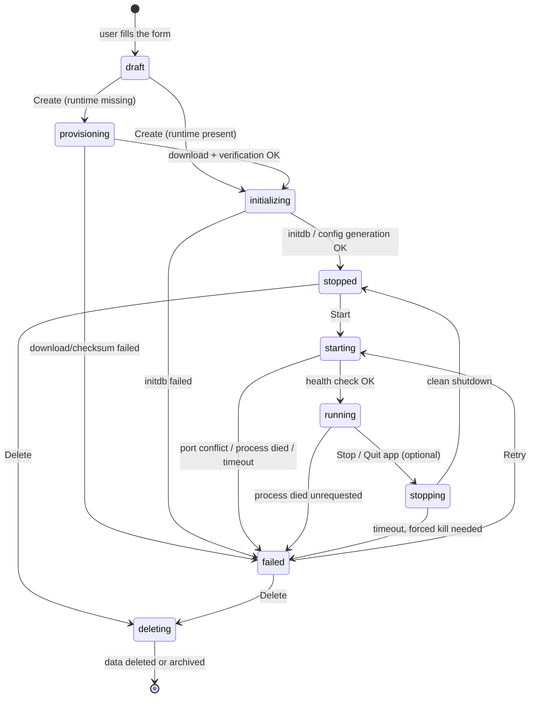
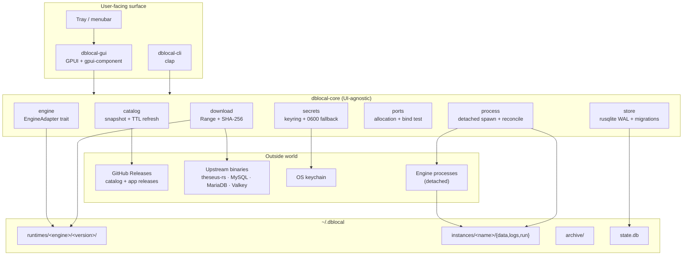

# PRD — DBLocal

Version: 0.1 · Status: Draft · Date: 2026-11-20 · Owner: rezkycodes

---

## 1. Summary

**DBLocal** is a Rust desktop app that installs and manages database servers **on the developer's local machine**: PostgreSQL, MySQL, MariaDB and Valkey (Redis-compatible). The target is a web developer juggling many projects at once, stuck today between two bad options — installing a database through the OS package manager (one version per machine, sudo required, port conflicts) or running `docker compose` per project (heavy on RAM and battery, a YAML file to maintain, a terminal to keep open).

The core value is one thing: **several engine versions running side by side as native processes, started and stopped with one click, with no containers and no terminal.**

The app is free and open source under **GPL-3.0-only**, with no telemetry, no accounts, and it never asks for sudo at runtime. It **does not distribute engine binaries**; it downloads them from upstream sources, verifies their SHA-256, and runs them as user-owned processes under `~/.dblocal/`.

Phase 1 ships an end-to-end vertical slice that really works: catalog of versions → download and verify → create a PostgreSQL or Valkey instance → run it on a port that is guaranteed free → copy the connection URI → manage it from the tray, complete with a log viewer for failure paths and install artifacts (AppImage, .tar.gz, notarized .dmg, .zip, plus `install.sh` for `curl`).

DBLocal manages **servers**, not **data**. Browsing tables and running queries are permanent non-goals — that is the job of DBDelve, TablePlus or DBeaver, and DBLocal provides a button to open them there.

---

## 2. Problem & Jobs-to-be-Done

### Today's situation

Primary user: **a web/full-stack developer (Laravel, Node/Next, Rails, Python) who actively holds 3–10 local projects at once**, on Windows, macOS or Linux.

What they do today, and what fails:

| Current approach | What breaks |
|---|---|
| `dnf install postgresql-server` / `brew install mysql` / EDB installer | One major version per machine. An old project needs PG 14, a new one needs PG 18 → one has to give. sudo required, a system service always running, uninstall leaves traces. |
| `docker compose up` per project | Docker Desktop eats RAM and battery even at idle; needs a maintained YAML file; an extra abstraction layer when debugging; on Windows it needs WSL2. |
| XAMPP / Laragon | Locked to one stack and one version; Windows-only; runs a system service as administrator. |
| DBngin | Solves exactly this problem — but has no Linux build and no CLI. |

### Primary job (first session)

> "I open the app, pick PostgreSQL 18, click Create, and within under 2 minutes I have a running server with a connection string I can paste into my project's `.env` — without opening a terminal once."

### Core value (one, not three)

**Multi-version native, one click, no container.**
Supporting attributes (not the main promise): cross-OS, lightweight, one panel for every engine.

### Retention trigger

A **permanent tray/menubar icon** with start/stop per instance without opening a window, plus **autostart at login**. Retention comes from daily utility: DBLocal becomes part of the "start work" ritual, not from new content.

---

## 3. Goals, Metrics & Non-goals

Because DBLocal **has no telemetry** (D-05), no metric relies on reporting from the user's machine. Product metrics are measured as **automated tests in CI** on a runner per OS; adoption metrics use **public proxies**.

| Goal | Metric | Target | How it is verified |
|---|---|---|---|
| First session succeeds, quickly | TTFRI (time-to-first-running-instance), PostgreSQL | p50 < 120 s @ 20 Mbps | E2E test in CI, bandwidth throttled |
| First session succeeds, large engine | TTFRI MySQL (80 MB Linux x86_64 minimal artifact, 168 MB macOS, 281 MB Windows; full 832 MB Linux aarch64 ≈ 333 s excluded, see D-24) | p50 < 300 s @ 20 Mbps | E2E test in CI |
| Feels native, not web | Cold start from launch to interactive window | p95 < 1.5 s | CI benchmark (NVMe, standard runner) |
| Lighter than Docker | App RSS at idle (no instance running) | < 220 MB (OPEN-08, Rezky's decision 2026-11-25) | CI benchmark |
| Easy to install | Installer size per platform | < 60 MB | Artifact size gate in CI |
| Runs on every target | Engine install success across the OS matrix | 100% (first release targets: Linux x86_64/aarch64, Windows x86_64; macOS deferred, D-26) | E2E job per OS on every release |
| Fast start | PostgreSQL stopped → accepting connections | p95 < 5 s | E2E |
| Fast start | Valkey stopped → accepting connections | p95 < 1 s | E2E |
| Adoption | Downloads per release (GitHub Releases API) | rising trend between minor releases | Public |
| Release quality | Ratio of issues labeled `install-failure` ÷ release downloads | < 2% | Public, counted by hand per release |

### Non-goals

- **In-app data browsing/query** (table grid, SQL editor, CSV export). Permanently out of scope — DBLocal provides an "Open in…" button to DBDelve/TablePlus/DBeaver/psql.
- **Server/headless mode.** DBLocal is a developer-machine tool, not a production service manager. No systemd system unit, no Windows Service, never asks for sudo at runtime.
- **Auto-restart on engine crash** (v1). A direct consequence of the daemon-free architecture (D-10). A crash shows as `failed` plus a log, not a silent restart.
- **Major-version upgrade with data migration** (`pg_upgrade`, `mysql_upgrade`). Moving from PG 17 to 18 means creating a new instance and moving the data yourself (manual dump/restore outside the app).
- **Scheduled backup/restore** and **project profiles / instance groups** — Backlog, evaluated from real user issues.
- **Adopting an existing database install on the machine** (systemd/brew/EDB service). Cross-OS detection is too fragile and risks breaking the user's working setup.
- **User/account management in the app.** Single-machine, single-user; no login, no cloud sync.
- **Architecture support beyond x86_64 and aarch64** (ppc64le, i386, riscv).

---

## 4. Actors & Role Matrix

There is no authentication system: DBLocal runs as a process owned by the logged-in OS user, and its authority is that user's filesystem permissions.

| Actor | Who | Enters at |
|---|---|---|
| **User-GUI** | A person using the DBLocal window / tray menu | Phase 1 |
| **User-CLI** | A person or script (npm script, Makefile, local CI) using the `dblocal` binary | Phase 2 |
| **OS-Autostart** | The OS login item (systemd --user, LaunchAgent, Registry Run) that starts DBLocal in tray mode | Phase 3 |
| **Engine process** | A detached database process that the app controls, not owns | Phase 1 |

| Capability | User-GUI | User-CLI | OS-Autostart | Engine process |
|---|---|---|---|---|
| Browse the version catalog | ✅ | ✅ (P2) | — | — |
| Download and install an engine runtime | ✅ | ✅ (P2) | — | — |
| Create / delete an instance | ✅ | ✅ (P2) | — | — |
| Start / stop an instance | ✅ | ✅ (P2) | ✅ (P3, only instances flagged for autostart) | — |
| View and copy credentials | ✅ | ✅ (P2, `uri`) | — | — |
| Read instance logs | ✅ | ✅ (P2) | — | writes |
| Create databases and users inside an instance | ✅ (P2) | ❌ | — | — |
| Change the engine configuration | ✅ (P3) | ❌ | — | reads |
| Modify state outside `~/.dblocal` | ❌ | ❌ | ❌ | ❌ |
| Request sudo / elevation | ❌ (never, by design) | ❌ | ❌ | ❌ |

---

## 5. Feature Map

```mermaid
graph TD
  ROOT[DBLocal]

  ROOT --> P0[Phase 0 · Spikes]
  P0 --> SPK[F-SPK Spikes &amp; Foundation]

  ROOT --> P1[Phase 1 · MVP vertical slice]
  P1 --> CAT[F-CAT Engine Catalog]
  P1 --> RTM[F-RTM Runtime Installer]
  P1 --> PRT[F-PRT Port Manager]
  P1 --> INS[F-INS Instance Lifecycle]
  P1 --> CRD[F-CRD Credentials &amp; Connection]
  P1 --> LOG[F-LOG Logs &amp; Diagnostics]
  P1 --> TRY[F-TRY Tray &amp; Window]
  P1 --> PKG[F-PKG Packaging &amp; Install]

  ROOT --> P2[Phase 2 · MySQL family, CLI, complete packages]
  P2 --> ENG[F-ENG MySQL &amp; MariaDB]
  P2 --> DBU[F-DBU Database &amp; User Mgmt]
  P2 --> OPN[F-OPN Open in External Client]
  P2 --> CLI[F-CLI Command Line Interface]

  ROOT --> P3[Phase 3 · Configuration &amp; polish]
  P3 --> CFG[F-CFG Config Editor]
  P3 --> AUT[F-AUT Autostart]
  P3 --> PLH[F-PLH Polish &amp; Accessibility]
```



| ID | Feature | Phase | Priority | Role | Depends on |
|---|---|---|---|---|---|
| F-SPK | Spikes & workspace foundation | 0 | must | — | — |
| F-CAT | Engine Catalog | 1 | must | User-GUI | F-SPK |
| F-RTM | Runtime Installer | 1 | must | User-GUI | F-CAT |
| F-PRT | Port Manager | 1 | must | User-GUI | F-SPK |
| F-INS | Instance Lifecycle | 1 | must | User-GUI | F-RTM, F-PRT |
| F-CRD | Credentials & Connection | 1 | must | User-GUI | F-INS |
| F-LOG | Logs & Diagnostics | 1 | must | User-GUI | F-INS |
| F-TRY | Tray & Window | 1 | must | User-GUI | F-INS |
| F-PKG | Packaging & Install | 1 | must | — | F-SPK |
| F-ENG | MySQL & MariaDB engines | 2 | must | User-GUI | F-INS |
| F-DBU | Database & User Management | 2 | must | User-GUI | F-INS, F-CRD |
| F-OPN | Open in External Client | 2 | should | User-GUI | F-CRD |
| F-CLI | Command Line Interface | 2 | should | User-CLI | F-INS |
| F-CFG | Config Editor | 3 | should | User-GUI | F-INS |
| F-AUT | Autostart | 3 | should | OS-Autostart | F-TRY, F-INS |
| F-PLH | Polish & Accessibility | 3 | should | User-GUI | F-TRY |

---

## 6. Feature Specifications

### F-SPK — Spikes & Foundation (Phase 0)

- **Goal:** pay down the biggest technical risks up front, before there is expensive product code to throw away.
- **Roles:** —
- **Sub-features:**

  **F-SPK-01 — GPUI runs on three OSes**
  - AC1: Given a Linux CI runner with a Vulkan driver, When the spike binary runs, Then a GPUI window opens and renders a list plus buttons from `gpui-component`, then exits with code 0.
  - AC2: Given a Linux machine **without** Vulkan, When the binary runs, Then the app exits with an actionable message (naming the driver packages needed plus a documentation link), **not** a panic or a black screen.
  - AC3: Given Windows 11 x86_64 and macOS 14+ (arm64), When the binary runs, Then a window opens and renders the same components.
  - Entities: — · Output: `docs/spikes/gpui-platform.md`

  **F-SPK-02 — Valkey build for Windows & macOS**
  - AC1: Given Valkey 8.x/9.x source, When a CI job runs the CMake build on `windows-latest`, Then it produces `valkey-server.exe` that starts, serves `PING` → `PONG`, and shuts down cleanly.
  - AC2: Given the `macos-latest` runner (arm64) and `macos-13` (x86_64), When the build runs, Then it produces a binary for both architectures with the same `PING` result.
  - AC3: Given one target fails after a reasonable effort, Then the D-13 fallback decision is triggered: Valkey is marked `unsupported` for that platform in the catalog, the UI shows the reason plus a suggestion, and this PRD is updated.
  - Entities: — · Output: `docs/spikes/valkey-build.md`

  **F-SPK-03 — PostgreSQL lifecycle from the upstream tarball**
  - AC1: Given a `theseus-rs/postgresql-binaries` 18.x artifact for the runner's platform, When the spike downloads it, verifies SHA-256, extracts, runs `initdb`, then `pg_ctl start`, Then a TCP connection to `127.0.0.1:<port>` succeeds with `SELECT 1`.
  - AC2: Given the cycle in AC1 is complete, When `pg_ctl stop -m fast` is called, Then the process ends in under 5 seconds and no orphaned postgres process remains.
  - Entities: — · Output: `docs/spikes/postgres-lifecycle.md`

  **F-SPK-04 — Tray icon on three OSes alongside GPUI**
  - AC1: Given GPUI has its own event loop, When the tray icon is installed (third-party crate or direct platform API), Then the icon appears on Windows, macOS, and at least one Linux desktop environment (GNOME via the AppIndicator extension, and KDE).
  - AC2: Given the tray menu is clicked, Then the action reaches app state without blocking or breaking the GPUI event loop.
  - AC3: Given the tray is unavailable in the user's desktop environment, Then the app still works fully through the window, and the missing tray is shown as a note, not an error.
  - Entities: — · Output: `docs/spikes/tray-icon.md`
  - Risk note: GPUI was not designed with the tray as a first-class citizen; this spike carries the second-highest uncertainty after F-SPK-02, and the retention trigger (D-04) depends on it.

  **F-SPK-05 — Workspace skeleton & CI matrix**
  - AC1: Given an empty repo, When `cargo xtask ci` runs locally, Then the workspace (`core`, `gui`, `cli`, `xtask`) compiles, clippy is clean, and the tests pass.
  - AC2: Given a push to `main`, When the workflow runs, Then the `linux-x86_64`, `linux-aarch64`, `macos-universal` and `windows-x86_64` matrix all produce artifacts and `checksums.txt`.
  - Entities: —

- **Definition of done Phase 0:** all five spikes produce a documented YES/NO answer. If F-SPK-02 fails, the D-13 fallback runs **before** Phase 1 starts.

---

### F-CAT — Engine Catalog (Phase 1)

- **Goal:** be the single source of truth about "which versions exist, for which platform, from which URL, with which checksum" — without scraping HTML at runtime.
- **Roles:** User-GUI (read), CI job (write).
- **Business rules:**
  - The catalog is a versioned-schema JSON file (`schema_version`), bundled in the app at release time **and** refreshed from GitHub raw.
  - Every artifact entry **must** have `sha256`, `size_bytes` and `url`. An entry without a checksum is never shown as installable.
  - The catalog lists only versions **supported upstream**; EOL versions are flagged `eol: true` and hidden behind a "Show old versions" toggle.
- **Sub-features:**

  **F-CAT-01 — Bundled snapshot + periodic refresh**
  - AC1: Given the app is opened for the first time without an internet connection, When the catalog page is opened, Then the version list from the bundled snapshot still shows, with a "The catalog may be out of date" banner.
  - AC2: Given the last snapshot was refreshed more than 24 hours ago and a connection exists, When the app opens, Then the refresh runs in the background and the UI updates without blocking interaction.
  - AC3: Given the refresh fails (timeout, 404, or GitHub rate limit), Then the failure shows no error dialog; only the catalog status banner changes, and the old snapshot stays in use.
  - AC4: Given the catalog payload has a `schema_version` higher than the app understands, Then the app rejects that payload, keeps using the bundled snapshot, and suggests updating the app.
  - Entities: CatalogSnapshot, EngineVersion, Artifact

  **F-CAT-02 — Version list & filter**
  - AC1: Given the catalog loads, When the user opens "New Instance", Then only versions with an artifact for this machine's OS+arch are shown.
  - AC2: Given an engine has no artifact at all for this platform (e.g. Valkey on Windows if F-SPK-02 fails), Then that engine stays visible but disabled with a textual reason, not silently hidden.
  - AC3: Given a version is already installed as a local runtime, Then that version is marked "Installed" and creating an instance from it skips the whole download step.
  - Entities: EngineVersion, Artifact, Runtime

  **F-CAT-03 — Catalog builder pipeline (CI)**
  - AC1: Given a daily scheduled job, When the job runs, Then it queries each engine's upstream source (GitHub Releases for PostgreSQL, `downloads.mariadb.org/rest-api` for MariaDB, the official MySQL download endpoint, `download.valkey.io` for Valkey) and produces `catalog/engines.json`.
  - AC2: Given a new artifact is found, When the job processes it, Then it downloads the upstream `.sha256` file when one exists, or computes the checksum itself, and refuses to write an entry without a checksum.
  - AC3: Given the result differs from the current catalog, Then the job opens a pull request (not a direct push) so catalog changes can always be reviewed by a human.
  - Entities: EngineVersion, Artifact

- **Edge cases:** GitHub API rate limit (use `If-None-Match`/ETag and token auth in CI) · upstream changes its URL pattern (the job fails hard and notifies, the old catalog stays valid) · the user's system clock is wrong so the TTL never expires (the TTL is computed as `max(0, now - fetched_at)`; a negative value is treated as expired).

---

### F-RTM — Runtime Installer (Phase 1)

- **Goal:** turn a catalog entry into a ready-to-use binary directory under `~/.dblocal/runtimes/<engine>/<version>/`, with proven integrity.
- **Roles:** User-GUI
- **Business rules:**
  - SHA-256 verification is **mandatory** and happens before extraction. There is no "skip verification" option.
  - The download is written to a temporary `*.part` file in the same directory as the final destination (so the `rename` is atomic and on one filesystem).
  - One runtime is shared by many instances; a runtime is never removed automatically.
- **Sub-features:**

  **F-RTM-01 — Resumable download with progress**
  - AC1: Given a large download (e.g. 281 MB) is running, When the connection drops and the user presses "Resume", Then the download continues with an HTTP `Range` header from the last byte, not from zero.
  - AC2: Given a download is running, Then the UI shows percent, bytes downloaded/total, speed and ETA, updated at least twice per second.
  - AC3: Given the server does not support `Range` (responds 200 rather than 206), Then the app restarts from the beginning transparently, without showing an error.
  - AC4: Given the user presses "Cancel", Then the download stops in under 1 second and the `.part` file is deleted.
  - Entities: DownloadJob, Artifact

  **F-RTM-02 — Verification & clean failure**
  - AC1: Given the download finishes, When the computed SHA-256 differs from the catalog value, Then the file is deleted, the install is cancelled, and the message names the expected vs. actual checksum with a "Retry" button.
  - AC2: Given extraction fails midway (disk full, corrupt archive), Then the half-built runtime directory is removed entirely so a runtime is never left half-installed.
  - AC3: Given the archive contains a path that escapes the destination directory (`../`) or an absolute symlink, Then extraction is refused as an unsafe archive (zip-slip protection).
  - Entities: Runtime, DownloadJob

  **F-RTM-03 — Extraction & runtime layout**
  - AC1: Given a `.tar.gz`, `.tar.xz` or `.zip` archive, When it is extracted, Then its contents land in `~/.dblocal/runtimes/<engine>/<version>-<arch>/` with the catalog's `strip_prefix` applied so `bin/` sits exactly one level inside.
  - AC2: Given a Unix platform, When extraction finishes, Then the executable bit on each file in `bin/` is set.
  - AC3: Given a runtime already exists for the same version+arch, Then the download is skipped and the status is immediately `installed`.
  - Entities: Runtime

  **F-RTM-04 — Reclaim disk**
  - AC1: Given a runtime is no longer referenced by any instance, When the user opens Settings → Storage, Then that runtime is listed as "Unused" with its size and can be deleted.
  - AC2: Given a runtime is still referenced by at least one instance, Then its delete button is disabled with the list of instances using it.
  - *Status (v0.3): implemented in the dock's RUNTIMES section (not Settings → Storage) and as `dblocal runtime list|remove`; unused runtimes show their size and a remove control, used ones a disabled control. Removal is refused while an instance uses the runtime, is mutually exclusive with a concurrent create/install across processes, re-validates the path, and is retryable after a partial failure.*
  - Entities: Runtime, Instance

- **Edge cases:** not enough disk (check free space ≥ `size_bytes × 3` before starting, not after failing) · Windows antivirus locks a file during extraction (retry with backoff, then a message naming antivirus) · paths longer than 260 characters on Windows (use `\\?\` verbatim paths).

---

### F-PRT — Port Manager (Phase 1)

- **Goal:** guarantee a new instance never fails to start because of a port, and keep an existing project's `.env` working unchanged.
- **Roles:** User-GUI
- **Business rules:**
  - Canonical port per engine: PostgreSQL 5432, MySQL 3306, MariaDB 3307, Valkey 6379.
  - The first instance of an engine gets the canonical port; the next ones take the next free port.
  - Port ownership is recorded in a table with a **unique constraint**, and is always re-verified with a real bind test before start.
- **Sub-features:**

  **F-PRT-01 — Automatic allocation**
  - AC1: Given there is no PostgreSQL instance yet, When the user creates a PostgreSQL instance, Then the proposed port is 5432.
  - AC2: Given an instance already uses 5432, When the user creates a second PostgreSQL instance, Then the proposed port is 5433 (the next free port, skipping those already allocated inside the app).
  - AC3: Given the user types a port already allocated to another DBLocal instance, Then the form refuses to submit and names the owning instance.
  - Entities: PortAllocation, Instance

  **F-PRT-02 — Bind test before start**
  - AC1: Given the instance's port is taken by a process outside DBLocal (e.g. a system PostgreSQL or a container), When the user presses Start, Then the app detects it through a real bind attempt to `127.0.0.1:<port>` **before** running the engine, and shows a "Port 5432 is already in use" dialog with a one-click "Move to 5433" action.
  - AC2: Given the user chooses to move the port, Then the instance configuration is updated, the old port allocation is released, and the start continues with no extra steps.
  - AC3: Given the bind test succeeds, Then the test socket is closed before the engine runs, so there is no race with the engine process itself.
  - Entities: PortAllocation, Instance

- **Edge cases:** a manually typed port below 1024 (rejected with the explanation "needs privileges; DBLocal never asks for sudo") · `SO_REUSEADDR` makes a bind look successful even when another listener exists (the bind test uses default options without reuse, and on Windows uses `SO_EXCLUSIVEADDRUSE`) · IPv6 `::1` is taken while `127.0.0.1` is free (test both stacks, report if either fails).

---

### F-INS — Instance Lifecycle (Phase 1)

- **Goal:** the core of the product — create, start, stop and delete database instances, staying correct even when the app is closed midway.
- **Roles:** User-GUI
- **State machine:**



  Transition triggers: all transitions are triggered by **User-GUI** (or User-CLI from Phase 2), except `running → failed`, which is triggered by the **Engine process** dying, and `starting → failed` by the health-check timeout.

- **Business rules:**
  - Instance names are unique, `^[a-z0-9][a-z0-9-]{1,30}$`, and used as the data directory name.
  - Data dir: `~/.dblocal/instances/<name>/data`, logs: `~/.dblocal/instances/<name>/logs/`, pidfile: `~/.dblocal/instances/<name>/run/`.
  - The engine is spawned **detached** (`setsid` on Unix, `DETACHED_PROCESS | CREATE_NEW_PROCESS_GROUP` on Windows) so it does not die when the app quits.
  - The health check is a **real protocol connection** (PostgreSQL: `pg_isready`/handshake; Valkey: `PING`; MySQL/MariaDB: handshake), not just "the process is alive".
  - Start timeout: 30 seconds (PostgreSQL/MySQL/MariaDB), 10 seconds (Valkey). Past that → `failed` plus the log shown automatically.
  - Stop uses the engine's clean shutdown first (`pg_ctl stop -m fast`, `mysqladmin shutdown`, `SHUTDOWN NOSAVE`/SIGTERM); SIGKILL only after 20 seconds and is recorded in the log as a forced kill.
- **Sub-features:**

  **F-INS-01 — Create an instance**
  - AC1: Given the user picks an engine + version and presses Create, When the required runtime is already installed, Then the instance is created in status `stopped` in under 10 seconds with no question beyond the name (pre-filled with a default).
  - AC2: Given the runtime is not installed, Then the flow continues automatically to F-RTM with visible progress, then returns to initialization without user interaction.
  - AC3: Given the instance name is taken, Then the form refuses and suggests an alternative name.
  - Entities: Instance, Runtime, PortAllocation, CredentialRef

  **F-INS-02 — Initialize the data directory**
  - AC1: Given a new PostgreSQL instance, When initialization runs, Then `initdb` is called with UTF-8 encoding, `C.UTF-8` locale (or platform equivalent), and the authentication method matching the chosen auth mode (`scram-sha-256` or `trust`).
  - AC2: Given a new Valkey instance, Then a `valkey.conf` is written containing `bind 127.0.0.1`, `port <port>`, `dir <data_dir>`, and `requirepass` when the auth mode has a password.
  - AC3: Given initialization fails, Then the data directory is cleaned up entirely and the raw output from the engine tool is shown in the log panel, not summarized into "an error occurred".
  - AC4: Given any platform, Then every engine is configured to listen on `127.0.0.1` (and `::1`) **only**, never `0.0.0.0`.
  - Entities: Instance, Runtime

  **F-INS-03 — Start / Stop**
  - AC1: Given a `stopped` instance, When the user presses Start, Then the F-PRT-02 bind test runs, the engine is spawned detached, and the status becomes `running` after the health check passes.
  - AC2: Given a `running` instance and the user closes the app window and quits fully, When the app is opened again, Then the instance is still `running` and still controllable.
  - AC3: Given a `running` instance, When the user presses Stop, Then clean shutdown is called and the status becomes `stopped` in under 20 seconds; past that, a forced kill runs and is recorded.
  - AC4: Given the engine process dies on its own, When the app detects it (poll ≤ 2 seconds), Then the status becomes `failed` and the last 20 log lines are shown without being asked.
  - Entities: Instance, PortAllocation

  **F-INS-04 — Reconcile orphaned processes**
  - AC1: Given the app starts and a pidfile exists from a previous session, When reconciliation runs, Then each PID is verified not just as "present" but as **really our engine process**, by matching the executable name and process start time against the recorded values.
  - AC2: Given a PID has been reused by another process that does not match, Then the pidfile is treated as stale, deleted, and the instance marked `stopped` — the app never signals a foreign process.
  - AC3: Given reconciliation for 20 instances, Then it all finishes in under 2 seconds and does not block the window render.
  - Entities: Instance

  **F-INS-05 — Delete an instance**
  - AC1: Given the user presses Delete, Then the dialog shows the current data dir size and two actions: "Delete instance and data" and "Delete instance, keep data".
  - AC2: Given the user chooses "Delete instance and data", Then the confirm button becomes enabled only after the user types the instance name exactly.
  - AC3: Given the user chooses "Delete instance, keep data", Then the data directory is moved to `~/.dblocal/archive/<name>-<YYYYMMDD-HHMM>/`, the instance entry is deleted, the port allocation is released, and the keychain credential is deleted.
  - AC4: Given the instance is `running`, Then Delete stops it first and fails cleanly if the stop fails.
  - Entities: Instance, ArchivedData, PortAllocation, CredentialRef

- **Edge cases:** a data dir exists but the app does not recognize it (instance recreated with the same name → refuse, ask for another name or restore from archive) · the system clock moves backward so process start-time comparison misses (tolerance ±2 seconds; when in doubt → treat as stale) · home directory on a network filesystem (warn: the engine needs correct POSIX locking) · the OS user name contains spaces/non-ASCII (paths are quoted in every process call; tested in CI).

---

### F-CRD — Credentials & Connection (Phase 1)

- **Goal:** make the last step of the first session — "paste into `.env`" — a single click, without storing passwords carelessly.
- **Roles:** User-GUI
- **Business rules:**
  - Default: a canonical superuser (`postgres`, `root`, `default` for Valkey) with a random **24-character** password from a CSPRNG.
  - The password is stored in the OS keychain (Secret Service/libsecret on Linux, Keychain on macOS, Credential Manager on Windows). Fallback when the keychain is unavailable: `~/.dblocal/secrets/<instance>.key` with mode `0600` — and the fact that the fallback is in use is shown in the UI.
  - **A password is never written to `state.db`, to logs, or to error messages.**
  - The "no password" mode can only be chosen at create time, is permanently marked in the instance UI, and carries a warning that names the risk.
- **Sub-features:**

  **F-CRD-01 — Generate & store credentials**
  - AC1: Given a new instance with the password auth mode, When it is created, Then a 24-character password is generated from the OS CSPRNG and stored in the keychain under the key `dblocal:<instance-id>`.
  - AC2: Given the keychain is unavailable (e.g. headless Linux without Secret Service), Then the `0600` file fallback is used and the UI shows the note "Stored in a file, not the keychain" with its path.
  - AC3: Given an instance is deleted, Then its keychain/file entry is deleted too.
  - Entities: CredentialRef, Instance

  **F-CRD-02 — Copy the connection URI**
  - AC1: Given a `running` instance, When the user presses "Copy URI", Then the clipboard holds a complete, valid URI, e.g. `postgresql://postgres:<password>@127.0.0.1:5432/postgres`, and a confirmation toast appears.
  - AC2: Given a Valkey instance, Then the URI is `redis://default:<password>@127.0.0.1:6379` (the `redis://` scheme is used because that is what clients understand).
  - AC3: Given the user presses "Copy .env", Then the clipboard holds a framework-style environment variable block (`DB_CONNECTION`, `DB_HOST`, `DB_PORT`, `DB_DATABASE`, `DB_USERNAME`, `DB_PASSWORD`).
  - AC4: Given the password contains characters that need escaping in a URI, Then the password is percent-encoded correctly so the URI can always be parsed.
  - Entities: Instance, CredentialRef

  **F-CRD-03 — No-password mode**
  - AC1: Given the user checks "Allow connections without a password" at create time, Then a warning dialog explains that other processes and users on this machine can connect without credentials, and the user must confirm once more.
  - AC2: Given this mode is active, Then the instance card shows a permanent "No auth" badge.
  - AC3: Given a Valkey engine with this mode, Then `protected-mode yes` is still kept in the config as the last line of defense.
  - Entities: Instance

- **Edge cases:** the keychain is locked while the app runs (ask for an unlock through the OS API; if that fails, show instructions and do not crash) · the user copies the URI while the instance is `stopped` (the URI is still provided, with a note that the instance is not running).

---

### F-LOG — Logs & Diagnostics (Phase 1)

- **Goal:** when something fails, the user must be able to see the cause without opening a terminal. This is the failure path of the core value, so it is mandatory in Phase 1.
- **Roles:** User-GUI
- **Sub-features:**

  **F-LOG-01 — Per-instance log panel**
  - AC1: Given an instance has been started, When the user opens the Logs tab, Then the last 1,000 lines are shown and new lines stream live while the instance is `running`.
  - AC2: Given the log file exceeds 10 MB, Then the log is rotated (`.1`, `.2`, at most 3 files) so the disk does not grow without bound.
  - AC3: Given the user presses "Copy logs", Then the last 500 lines go to the clipboard, to paste into a GitHub issue.
  - Entities: Instance

  **F-LOG-02 — Start-failure diagnosis**
  - AC1: Given a start failed, When the app shows the failure, Then the message maps a known cause to an action: port in use → "Change port"; data dir created by another engine version → "Version mismatch, a new instance is required"; permission denied → the offending path; binary missing/corrupt → "Reinstall the runtime".
  - AC2: Given an unrecognized cause, Then the app shows the last relevant raw log line plus a "Report an issue" button that opens GitHub with a filled-in template (OS, architecture, app version, engine, engine version) — **without** including the password or an identifying home path.
  - Entities: Instance

---

### F-TRY — Tray & Window (Phase 1)

- **Goal:** realize the retention trigger (D-04): control the database without opening a window.
- **Roles:** User-GUI
- **Sub-features:**

  **F-TRY-01 — Tray menu**
  - AC1: Given the app is running, Then the tray/menubar icon shows the list of instances with status dots (green `running`, grey `stopped`, red `failed`) and allows start/stop directly from the menu.
  - AC2: Given an instance is changed from the tray menu, Then the main window (when open) reflects the change within ≤ 1 second.
  - AC3: Given the tray is unsupported in the user's desktop environment, Then the app still works fully through the window and shows the note once.
  - Entities: Instance

  **F-TRY-02 — Close & quit behavior**
  - AC1: Given the user closes the window, Then the app stays alive in the tray and instances keep running.
  - AC2: Given the user chooses Quit, When instances are still `running`, Then the dialog offers "Leave them running" (default) or "Stop all, then quit".
  - AC3: Given the user chooses "Leave them running", Then the engine processes stay alive after the app exits, and when the app is opened again F-INS-04 reconnects them.
  - Entities: Instance

---

### F-PKG — Packaging & Install (Phase 1 → Phase 2)

- **Goal:** meet the distribution requirement: `.rpm`, `.deb`, `.AppImage`, `.zip`, `.dmg`, and install through `curl`.
- **Roles:** —
- **Business rules:**
  - All artifacts are built in GitHub Actions from a tag; no manual builds from a developer machine.
  - Every release includes `checksums.txt` and GitHub's built-in attestation/provenance.
  - macOS **must** be signed with a Developer ID + notarized. Windows ships unsigned in v1, accompanied by SmartScreen documentation.
- **Sub-features:**

  **F-PKG-01 — Build matrix & checksum (P1)**
  - AC1: Given a `v*` tag is pushed, Then CI produces artifacts for `linux-x86_64`, `linux-aarch64`, `macos-universal`, `windows-x86_64` plus `checksums.txt`.
  - AC2: Given an artifact exceeds the 60 MB size limit, Then the build fails (size gate) rather than passing silently.

  **F-PKG-02 — Portable artifacts (P1)**
  - AC1: Given a Phase 1 release, Then `.AppImage` and `.tar.gz` (Linux), a notarized `.dmg` (macOS universal), and `.zip` (Windows) are available.
  - AC2: Given the AppImage runs on Fedora and the latest Ubuntu LTS, Then the app opens with no extra dependencies beyond the system Vulkan driver.
  - AC3: Given the `.dmg` is downloaded through a browser on macOS, Then the app opens without any terminal command (proof that notarization succeeded).

  **F-PKG-03 — install.sh for curl (P1)**
  - AC1: Given `curl -fsSL https://dblocal.dev/install.sh | sh` (or the GitHub raw URL) runs on Linux or macOS, Then the script detects OS+arch, downloads the right artifact, verifies the checksum, installs to `~/.local/bin` (or `/usr/local/bin` when writable), and prints the next step.
  - AC2: Given an unsupported architecture, Then the script stops with a clear message and installs **nothing**.
  - AC3: Given the script is run again, Then it performs an idempotent in-place upgrade.
  - AC4: The script passes `shellcheck` in CI and never calls `sudo` unless explicitly requested through a flag.

  **F-PKG-04 — Native packages (P2)**
  - AC1: Given a Phase 2 release, Then `.deb` (Debian/Ubuntu), `.rpm` (Fedora/RHEL), and `.msi` (Windows) are available.
  - AC2: Given `.deb`/`.rpm` is installed and then removed, Then no files are left behind outside `~/.dblocal` (user data is intentionally kept, and this fact is stated at uninstall time).

  **F-PKG-05 — Self-update (P2)**
  - AC1: Given a newer version is available on GitHub Releases, When the user opens Settings → Updates (or a periodic check runs), Then the new version plus release notes are shown with an install button.
  - AC2: Given the app was installed through the OS package manager (`.deb`/`.rpm`/Homebrew), Then self-update is disabled and the app points the user to their package manager.
  - AC3: Given the Windows platform, Then the update uses a helper process that replaces the binary after the app exits, because the running binary cannot be overwritten.
  - AC4: Given the update package, Then the checksum is verified before installing.

---

### F-ENG — MySQL & MariaDB (Phase 2)

- **Goal:** fulfill the four-engine promise by reusing the `EngineAdapter` already proven by the two most different engines in Phase 1.
- **Roles:** User-GUI
- **Sub-features:**

  **F-ENG-01 — MySQL adapter**
  - AC1: Given a MySQL artifact from the catalog, When an instance is created, Then initialization uses `mysqld --initialize-insecure`, then the superuser password is set and `my.cnf` is written with `bind-address=127.0.0.1`, `port`, and the instance `datadir`.
  - AC2: Given a `running` instance, Then the health check uses the MySQL protocol handshake, not just a process check.
  - AC3: Given a large download (e.g. 281 MB), Then progress and ETA are shown from the first byte and the download can be resumed after a drop.

  **F-ENG-02 — MariaDB adapter**
  - AC1: Given a MariaDB artifact from `downloads.mariadb.org/rest-api`, When an instance is created, Then initialization uses `mariadb-install-db` with `--auth-root-authentication-method=normal`.
  - AC2: Given MariaDB and MySQL are both installed, Then they appear as different engines with different canonical ports (3306 vs 3307) and never share a data dir.

- **Edge cases:** MySQL on macOS needs a dylib resolved relative to the binary (set `DYLD_LIBRARY_PATH` or fix the rpath during extraction) · the MySQL tarball for Linux is linked against a particular glibc (the catalog records `min_glibc`; mismatched versions are hidden for that platform).

---

### F-DBU — Database & User Management (Phase 2)

- **Goal:** close the last remaining reason to open a terminal: creating a database for a new project.
- **Roles:** User-GUI
- **Business rules:** every command runs through the client driver with **correct parameter/identifier quoting**, never by concatenating raw strings. Database/user names are validated against a character allowlist before being sent.
- **Sub-features:**

  **F-DBU-01 — Manage databases**
  - AC1: Given a `running` instance, When the user opens the Databases tab, Then the database list with sizes is shown.
  - AC2: Given the user creates a new database with a valid name, Then the database is created with UTF-8 encoding (`utf8mb4_unicode_ci` for the MySQL family) and appears in the list immediately.
  - AC3: Given the user deletes a database, Then the confirmation requires typing the database name.
  - AC4: Given a name contains characters outside `[A-Za-z0-9_]`, Then the form rejects it before any command is sent to the engine.
  - Entities: Instance

  **F-DBU-02 — Manage users & privileges**
  - AC1: Given the user creates a new database user, Then they can choose the database and the privilege level (read-only or read-write), and the matching GRANT command is run.
  - AC2: Given the user is created, Then its password is shown once and stored in the keychain like the superuser credential. *(v1 deviation accepted, Rezky's decision 2026-11-25: for v1, a new database user's password is only shown once and is not stored in the keychain.)*
  - Entities: Instance, CredentialRef

  **F-DBU-03 — Reset the superuser password**
  - AC1: Given the user presses "Reset password", Then a new password is generated, applied to the engine, stored in the keychain, and the displayed URI is updated with it.
  - AC2: Given the reset fails midway, Then the old password stays in effect and the keychain is unchanged.
  - Entities: Instance, CredentialRef

- **Note:** this tab never shows table contents. That boundary is what separates DBLocal from a DB client.

---

### F-OPN — Open in External Client (Phase 2)

- **Goal:** connect the "browsing data" non-goal to the tools meant for it, at near-zero implementation cost.
- **Roles:** User-GUI
- **Sub-features:**

  **F-OPN-01 — Detect installed clients**
  - AC1: Given the machine has DBDelve, TablePlus, DBeaver, or a CLI (`psql`, `mysql`, `valkey-cli`/`redis-cli`), When the user opens the "Open in…" menu, Then only clients actually detected are shown.
  - AC2: Given none is detected, Then the menu shows "Copy URI" instead, not an empty list.
  - Entities: Instance

  **F-OPN-02 — Open with the instance connection**
  - AC1: Given the user picks a GUI client, Then the client opens directly on that instance's connection (URL scheme when available, e.g. `tableplus://`, or command-line arguments).
  - AC2: Given the user picks a CLI client, Then the OS terminal opens with a ready-to-run command, and the password is supplied through environment variables (`PGPASSWORD`, `MYSQL_PWD`) — **not** as an argument visible in the process list.
  - Entities: Instance, CredentialRef

---

### F-CLI — Command Line Interface (Phase 2)

- **Goal:** make DBLocal usable from `package.json`, `Makefile`, and team onboarding scripts.
- **Roles:** User-CLI
- **Business rules:** the same binary as the GUI; with no arguments → opens the GUI, with a subcommand → CLI mode. Every command has a meaningful exit code (0 success, 1 general error, 2 bad arguments, 3 instance not found, 4 engine failed to start).
- **Sub-features:**

  **F-CLI-01 — Inspection**
  - AC1: Given several instances exist, When `dblocal list` runs, Then a name/engine/version/port/status table is printed; `--json` produces pipeable JSON.
  - AC2: Given `dblocal status <name>`, Then the instance status is printed with exit code 0 when `running`, and non-zero otherwise.

  **F-CLI-02 — Control**
  - AC1: Given `dblocal start <name>`, Then the command blocks until the health check passes or times out, then exits with the matching code.
  - AC2: Given the GUI is open while the CLI changes state, Then the GUI reflects the change within ≤ 2 seconds (SQLite state polling).
  - AC3: Given two processes try to start the same instance at once, Then one wins and the other exits with the message "already running" — guaranteed by the SQLite transaction, not by timing.

  **F-CLI-03 — Lifecycle & URI**
  - AC1: Given `dblocal uri <name>`, Then the connection URI is printed to stdout with no decoration, so it can be piped straight into `.env`.
  - AC2: Given `dblocal create --engine postgresql --version 18.7 --name app-dev`, Then the instance is created non-interactively, downloading the runtime when needed, and the URI is printed when done.
  - AC3: Given `dblocal delete <name>`, Then the delete refuses to run without `--yes` in a non-interactive session, and by default **archives** the data rather than deleting it.

---

### F-CFG — Config Editor (Phase 3)

- **Goal:** close the common tuning need without forcing the user to hunt for a configuration file.
- **Roles:** User-GUI
- **Sub-features:**

  **F-CFG-01 — Form for key settings**
  - AC1: Given a PostgreSQL instance, When the user opens the Config tab, Then the form shows the high-value subset (`port`, `max_connections`, `shared_buffers`, `work_mem`, `timezone`, authentication method) with current and default values. *(Accepted for v1, Rezky's decision 2026-11-25: the authentication method is read-only in the Config tab.)*
  - AC2: Given the user saves changes, Then the app states that a restart is required and offers to do it now.
  - AC3: Given a change makes the engine fail to start, Then the app offers "Restore the previous configuration" from a copy saved before the change.

  **F-CFG-02 — Edit the raw file**
  - AC1: Given the user chooses "Open config file", Then the file opens in the OS default text editor, and comments and lines the app does not recognize are never rewritten or deleted by the app.
  - Entities: Instance

---

### F-AUT — Autostart (Phase 3)

- **Goal:** complete the retention trigger: the databases you need are ready before you ask for them.
- **Roles:** OS-Autostart, User-GUI
- **Sub-features:**

  **F-AUT-01 — App autostart at login**
  - AC1: Given the user enables "Run at login", Then a login item is registered through the appropriate user-level mechanism: a systemd `--user` unit (Linux), a LaunchAgent (macOS), the Registry `Run` key (Windows) — without sudo.
  - AC2: Given the option is turned off, Then that entry is removed entirely.
  - AC3: Given the app is started by the login item, Then it opens straight to the tray without showing a window.

  **F-AUT-02 — Autostart selected instances**
  - AC1: Given an instance is flagged for autostart, When the app starts at login, Then that instance is started and the result (success/failure) is visible in the tray.
  - AC2: Given one instance's autostart fails, Then the failure does not block other instances and shows no modal dialog; a `failed` status in the tray and window is enough.
  - Entities: Instance

---

### F-PLH — Polish & Accessibility (Phase 3)

- **Goal:** make the app good enough to use every day by someone who does not use a mouse, and in both system themes.
- **Sub-features:**

  **F-PLH-01 — Full keyboard navigation**
  - AC1: Given only a keyboard, Then the whole first-session flow (pick engine → create → start → copy URI) can be completed, with focus always visible.
  - AC2: Given the command palette (`Ctrl/Cmd+K`), Then the user can search instances and run start/stop/copy URI.

  **F-PLH-02 — Theme & contrast**
  - AC1: Given a light or dark system theme, Then the app follows it, and all text meets a minimum contrast ratio of 4.5:1.
  - AC2: Given an instance status, Then status is never conveyed by colour alone (there is always a text label or accompanying icon).

---

## 7. Data Model

All app state lives in one SQLite file `~/.dblocal/state.db` (WAL mode). The catalog is cached derived data, not a source of truth.


| Entity | Key fields | Data owner (who creates/updates it) | Lifecycle |
|---|---|---|---|
| Engine | `key`, `canonical_port` | A constant inside the app | Static, changes only with an app release |
| EngineVersion | `engine_key`+`version` | Catalog CI job (F-CAT-03) | Refreshed from the catalog; old entries kept while a runtime still uses them |
| Artifact | `sha256`, `url` | Catalog CI job | Same as EngineVersion |
| Runtime | `path`, `state` | F-RTM | Hard delete through F-RTM-04, only when unreferenced |
| Instance | `name`, `port`, `status` | F-INS | Hard delete, with the option to archive the data dir |
| PortAllocation | `port` (unique) | F-PRT | Released when an instance is deleted or its port changes |
| CredentialRef | `key_ref` | F-CRD | Deleted with the instance; the secret lives in the keychain, not the DB |
| DownloadJob | `bytes_done`, `state` | F-RTM | Cleaned up 7 days after finishing |
| ArchivedData | `path`, `size_bytes` | F-INS-05 | Deleted only by hand through Settings → Storage |
| CatalogSnapshot | `fetched_at`, `etag` | F-CAT-01 | Only one active row; replaced on refresh |

### Personal data & retention

DBLocal **collects no personal data** and sends nothing to any server except: (a) HTTP requests to the engine download sources and the catalog, (b) version checks against the GitHub Releases API. No identifiers, no usage data. All state stays on the user's machine. Passwords live in the OS keychain, not in `state.db`. Therefore no personal-data-processing obligation under GDPR or Indonesia's PDP Law arises from this app — and this fact is stated in the README and on the Settings → Privacy page.

---

## 8. Command Surface

There is no network API — DBLocal has no server. Its public surface is the **core API** (used by the GUI and the CLI) and the **CLI**.

### Core API (crate `dblocal-core`)

| Operation | Lands in | Sub-feature |
|---|---|---|
| `catalog.refresh(force: bool)` | P1 | F-CAT-01 |
| `catalog.list_versions(engine, os, arch)` | P1 | F-CAT-02 |
| `runtime.install(engine, version) -> DownloadJob` | P1 | F-RTM-01..03 |
| `runtime.remove(runtime_id)` | P1 | F-RTM-04 |
| `ports.allocate(engine) -> u16` | P1 | F-PRT-01 |
| `ports.probe(port) -> BindResult` | P1 | F-PRT-02 |
| `instance.create(spec) -> Instance` | P1 | F-INS-01..02 |
| `instance.start(id)` / `instance.stop(id)` | P1 | F-INS-03 |
| `instance.reconcile_all()` | P1 | F-INS-04 |
| `instance.delete(id, DeleteMode)` | P1 | F-INS-05 |
| `creds.uri(id, UriFormat)` | P1 | F-CRD-02 |
| `logs.tail(id, lines)` | P1 | F-LOG-01 |
| `db.list/create/drop(instance_id, …)` | P2 | F-DBU-01 |
| `db.create_user(instance_id, …)` | P2 | F-DBU-02 |
| `config.read/write(instance_id, …)` | P3 | F-CFG-01 |
| `autostart.set(enabled)` | P3 | F-AUT-01 |

### CLI (Phase 2)

| Command | Role | Sub-feature |
|---|---|---|
| `dblocal list [--json]` | User-CLI | F-CLI-01 |
| `dblocal status <name>` | User-CLI | F-CLI-01 |
| `dblocal start <name>` | User-CLI | F-CLI-02 |
| `dblocal stop <name>` | User-CLI | F-CLI-02 |
| `dblocal uri <name> [--env]` | User-CLI | F-CLI-03 |
| `dblocal create --engine --version --name [--port] [--no-password]` | User-CLI | F-CLI-03 |
| `dblocal delete <name> [--yes] [--purge]` | User-CLI | F-CLI-03 |
| `dblocal logs <name> [-f]` | User-CLI | F-LOG-01 |

---

## 9. Architecture & Stack

Tech preference mode: **user** (Rust + GPUI chosen by the user; the rest by AI with approval)

| Layer | Choice | Source | Reason (requirement it satisfies) |
|---|---|---|---|
| Language & core | Rust (edition 2024) | user | One binary with no runtime, fast startup (< 1.5 s), full control over child processes and OS FFI — required to manage engine processes across OSes |
| UI | GPUI (`gpui-pre` 0.3.x) + `gpui-component` 0.10.x, Apache-2.0 | user | The desired look (Zed IDE style, see D-23 and `docs/design/UI-DIRECTION.md`), GPU-accelerated, no Electron/webview → supports the < 220 MB RAM target (OPEN-08). Apache-2.0 is one-way compatible with GPL-3.0, so it is valid inside a GPL product. **DBDelve code is still not copied — an engineering decision, not a licensing limitation (see D-06).** |
| Local state | SQLite via `rusqlite` (bundled), WAL mode | ai | The GUI and CLI are two processes; port allocation and status transitions need transactions (F-CLI-02 AC3) |
| HTTP | `reqwest` + `rustls` (no system OpenSSL) | ai | Resumable downloads (`Range`), and consistent TLS across 5 targets with no system dependency |
| Archives | `flate2`, `xz2`/`liblzma`, `zip` | ai | Upstream formats: `.tar.gz`, `.tar.xz`, `.zip` |
| Hash | `sha2` | ai | Mandatory integrity verification (F-RTM-02) |
| Secrets | `keyring` (Secret Service / Keychain / Credential Manager) + `0600` file fallback | ai | A password must never be in `state.db` (F-CRD-01) |
| Processes | `sysinfo` (PID validation: exe name + start time), `nix` (Unix), `windows-sys` (Windows) | ai | Reconciliation of orphaned processes that is safe against PID reuse (F-INS-04) |
| Async | `tokio` (multi-thread) **on its own thread** | ai | Parallel downloads and I/O without touching the GPUI executor |
| DB drivers | `tokio-postgres`, `mysql_async`, `redis` (RESP protocol) | ai | Real protocol health checks + F-DBU |
| CLI | `clap` (derive) | ai | Consistent exit codes and `--json` (F-CLI) |
| Packaging | `cargo-dist` or a custom `xtask` + `cargo-deb`, `cargo-generate-rpm`, `appimagetool`, `cargo-bundle`/`create-dmg`, WiX | ai | Produces `.deb`/`.rpm`/`.AppImage`/`.dmg`/`.zip`/`.msi` from one CI matrix |
| CI/CD & distribution | GitHub Actions + GitHub Releases + `install.sh` | user/ai | Zero infrastructure cost, built-in provenance, supports `curl \| sh` |

### Binding architecture rules

1. **`core` knows nothing about the UI.** There are no GPUI types in `core`. The GUI and CLI are both thin clients. (Consequence of D-11.)
2. **Tokio never runs on the GPUI executor.** The tokio runtime lives on a separate thread owned by `core`; results are sent to the UI through a channel and applied in `cx.spawn`/GPUI updates. (A direct lesson from the DBDelve codebase.)
3. **Engine processes belong to the OS, not to the GUI as children.** Spawn detached, pidfile with PID + exe name + start time, verify all three before sending any signal.
4. **Every byte that is executed is verified.** There is no code path that runs a binary whose checksum has not been matched.
5. **No writes outside `~/.dblocal`**, except: the login item when the user enables F-AUT, and the clipboard.
6. **Engines are added only through the `EngineAdapter` trait** — no `match engine_key` scattered outside the `engine/` module.

```rust
// crates/core/src/engine/mod.rs — the contract that must be enough for 4 engines
pub trait EngineAdapter: Send + Sync {
    fn key(&self) -> &'static str;
    fn canonical_port(&self) -> u16;
    fn initialize(&self, ctx: &InitContext) -> Result<()>;          // initdb / config generation
    fn spawn_command(&self, ctx: &RunContext) -> Command;           // start arguments
    fn health_check(&self, ctx: &RunContext) -> Result<Health>;     // protocol handshake
    fn shutdown(&self, ctx: &RunContext) -> Result<()>;             // clean stop
    fn connection_uri(&self, ctx: &RunContext, cred: &Credential) -> String;
    fn admin_ops(&self) -> Option<&dyn AdminOps>;                   // F-DBU, None for Valkey v1
}
```

### Architecture diagram



### Folder structure

```
dblocal/
├─ Cargo.toml                  # workspace
├─ crates/
│  ├─ core/
│  │  └─ src/
│  │     ├─ catalog/           # schema, bundled snapshot, TTL refresh
│  │     ├─ download/          # resumable, checksum, safe extraction
│  │     ├─ engine/            # trait + postgres.rs, mysql.rs, mariadb.rs, valkey.rs
│  │     ├─ instance/          # state machine, create/start/stop/delete
│  │     ├─ process/           # detached spawn, pidfile, reconciliation
│  │     ├─ ports/             # allocation + bind test
│  │     ├─ secrets/           # keyring + file fallback
│  │     ├─ store/             # rusqlite, schema migrations
│  │     └─ paths.rs           # the single source of ~/.dblocal paths
│  ├─ gui/
│  │  └─ src/
│  │     ├─ app.rs             # GPUI root
│  │     ├─ views/             # instances, new_instance, logs, settings
│  │     ├─ tray/              # per-OS tray integration
│  │     └─ theme.rs
│  ├─ cli/                     # clap, human output + --json
│  └─ xtask/                   # catalog build, packages, release, benchmark
├─ catalog/engines.json        # bundled snapshot
├─ packaging/
│  ├─ appimage/ · deb/ · rpm/ · msi/ · dmg/
│  └─ install.sh
├─ docs/
│  ├─ prd/dblocal/             # this document
│  └─ spikes/                  # Phase 0 output
└─ .github/workflows/          # ci.yml, release.yml, catalog.yml
```

**Compatibility Check:** ✅ pass. Conflicts found and already resolved: (1) GPUI forces the installer size target up from < 25 MB to < 60 MB — accepted in §3; (2) GPUI requires Vulkan on Linux — handled by NFR-SEC/NFR-COMPAT and F-SPK-01 AC2; (3) self-update on Windows cannot overwrite the running binary — handled by F-PKG-05 AC3; (4) the product is GPL-3.0-only — every dependency must be GPL-compatible (Apache-2.0, MIT, ISC and the SQLite public domain are all one-way compatible; crates licensed proprietary or Slint-style GPL-or-commercial are rejected), enforced by a `cargo deny` allowlist; (5) tokio vs. the GPUI executor — resolved by architecture rule #2.

---

## 10. Non-functional Requirements

| Category | Requirement | How it is verified |
|---|---|---|
| Performance | Cold start to interactive window p95 < 1.5 s | CI benchmark per OS, release gate |
| Performance | App idle RSS < 220 MB; idle CPU <= 1.5% (OPEN-08, Rezky's decision 2026-11-25) | CI benchmark |
| Performance | UI stays responsive (no frame > 100 ms) during a large download (up to 832 MB) | Structured manual test + profiling in CI |
| Performance | Reconcile 20 instances in < 2 s | Integration test |
| Performance | PostgreSQL stopped → accepting connections p95 < 5 s; Valkey < 1 s | E2E per OS |
| Scale | Supported up to 25 instances and 15 installed runtimes per machine | Integration test with fixtures |
| Compatibility | Linux: Fedora 41+, Ubuntu 22.04+, Debian 12+ (x86_64; aarch64 best-effort) | E2E job per distro in a container/VM |
| Compatibility | macOS 13+ universal (arm64 + x86_64); Windows 10 22H2+ / 11 x86_64 | E2E job per OS (macOS deferred for the first release, D-26) |
| Compatibility | No Vulkan driver on Linux → an actionable dialog/message, not a crash | F-SPK-01 AC2, automated test with `LIBGL`/ICD emptied |
| Compatibility | The Valkey `jammy` artifact must be proven to run on Fedora (glibc backward compatibility) | Fedora E2E job |
| Security | Every engine listens only on `127.0.0.1`/`::1`; never `0.0.0.0` | Integration test verifies the open sockets |
| Security | No password in `state.db`, logs, error messages, or process arguments | Unit tests + automated grep over log artifacts in CI |
| Security | SHA-256 verification is mandatory before extraction; there is no option to skip it | Negative test: corrupt artifact → install must fail |
| Security | Extraction rejects path traversal and absolute symlinks (zip-slip) | Test with a crafted malicious archive |
| Security | Never runs `sudo`, `pkexec`, or requests elevation at runtime | Code review + CI grep across all crates |
| Security | TLS through rustls with certificate verification; no option to disable | Code review + test |
| Security | `cargo audit` and `cargo deny` are clean at release | CI gate |
| Privacy | Zero network requests other than engine downloads, catalog refresh, and version checks — all documented in Settings → Privacy | Test with a recording proxy in CI; the host list is verified |
| Reliability | A failure midway through an install never leaves a half-built runtime or instance | Fault-injection test (connection drop, disk full, process killed) |
| Reliability | `state.db` survives an app killed forcibly (WAL + transactions) | `kill -9` test, then reopen |
| Observability | The app log rotates at `~/.dblocal/logs/app.log` (max 3 × 10 MB), level set by `DBLOCAL_LOG` | Manual test + rotation test |
| Observability | Every displayed error has a stable code (`DBL-xxxx`) to search in the docs | Review + message snapshot tests |
| Accessibility | The whole first-session flow can be completed with a keyboard; contrast ≥ 4.5:1; status not conveyed by colour alone | Manual checklist per release (F-PLH) |
| License | Every dependency (including transitive) is GPL-compatible; the allowlist is enforced by `cargo deny` and fails the build | CI gate |
| License | Every binary release ships with the matching source tag and a `COPYING` file (GPLv3 §6); the About page shows the license + third-party license list | CI gate + release review |
| Distribution | Every release artifact has a public checksum + GitHub attestation | CI gate |
| Distribution | The macOS `.dmg` is signed with a Developer ID and notarized | `spctl -a -vv` verification in CI |
| Distribution | `install.sh` passes `shellcheck`, is idempotent, and never calls `sudo` unless requested | CI gate |
| Size | Artifact per platform < 60 MB | CI gate |
| Maintainability | Source files < 800 lines; functions < 50 lines; no nesting beyond 4 levels | `clippy` + custom lint in CI |

---

## 11. Phase Plan

| Phase | Goal | Features | Definition of done |
|---|---|---|---|
| **0 — Spikes & foundation** | Prove the three riskiest assumptions before writing product code | F-SPK-01..05 | Five spikes documented with YES/NO answers. **Decision gate:** if F-SPK-02 (Valkey Windows) fails → the D-13 fallback runs and the PRD is updated before Phase 1. If F-SPK-04 (tray) fails → D-04 is replaced and the retention impact is recorded. Workspace + CI matrix green. |
| **1 — MVP vertical slice** | A developer can install DBLocal, run PostgreSQL or Valkey, and use it for a real project | F-CAT, F-RTM, F-PRT, F-INS, F-CRD, F-LOG, F-TRY, F-PKG-01..03 | On the first release targets — **Linux x86_64/aarch64 and Windows x86_64** (macOS deferred, D-26): download → create → start → copy URI → connect succeeds, with engines available per OS as the catalog says (no Valkey on Windows, D-26). TTFRI PostgreSQL p50 < 120 s measured in CI. An instance survives an app quit and reconnects when the app is opened. AppImage/.tar.gz (Linux) and .zip (Windows) + `install.sh` ship on GitHub Releases with checksums; the macOS `.dmg` follows when macOS is turned back on (D-26). |
| **2 — MySQL family, CLI & native packages** | The four-engine promise is met, and DBLocal works without a terminal **and** from inside one | F-ENG, F-DBU, F-OPN, F-CLI, F-PKG-04..05 | MySQL & MariaDB pass the same E2E as Phase 1. Creating a database for a new project can be done entirely from the GUI. `dblocal` subcommands complete with `--json` and exit codes. `.deb`/`.rpm`/`.msi` ship; self-update works on macOS & Windows and is disabled for package-manager installs. |
| **3 — Configuration, autostart & polish** | DBLocal becomes part of the daily routine and can be tuned without opening a file | F-CFG, F-AUT, F-PLH | A configuration form for all four engines with automatic recovery from a bad configuration. Autostart is installed through user-level mechanisms on three OSes and can be cleanly revoked. The accessibility checklist passes. |

### Phase Dependency Check ✅

| Check | Result |
|---|---|
| `phase(F) >= phase(dependsOn)` for every feature | ✅ pass (see the table in §5) |
| A feature that **displays** data has a feature that **creates** it in the same or an earlier phase | ✅ F-CAT-02 (displays versions) is preceded by F-CAT-03 (CI pipeline) and the bundled snapshot in Phase 1 |
| No feature needs login before an auth feature | ✅ not applicable — there is no user authentication (D-05, §4) |
| The core value is present in Phase 1 | ✅ "multi-version native, 1 click" is proven in Phase 1: two different PostgreSQL versions can run side by side on different ports, controlled with one click |
| The retention trigger has a feature that realizes it | ✅ F-TRY (tray, Phase 1) + F-AUT (autostart, Phase 3). **Note:** autostart only arrives in Phase 3 — Phase 1–2 retention rests on the tray alone; this is a knowingly accepted exception because autostart needs a stable F-TRY first |
| The first-session job can be completed in Phase 1 | ✅ create → start → copy URI, all in Phase 1 |
| Every feature has a role, a data source, and a link to job B1 | ✅ verified in §5 and §6 |

---

## 12. Decision Log

**D-01 | Primary user: a multi-project web developer who rejects Docker**
Context: a concrete segment is needed so scope decisions can be tested. Decision: a Laravel/Node/Next/Rails/Python developer holding 3–10 local projects, who today uses a manual install or `docker compose`. Consequence: features are judged by "does this help this person on an ordinary workday"; beginners and teams are not the primary target. Status: Approved.

**D-02 | First-session job: one running instance + a copied connection URI**
Context: one single outcome is needed to prove the whole chain. Decision: from app open to URI copied, target < 2 minutes including the download. Consequence: this becomes the primary Phase 1 acceptance and the TTFRI metric in CI. Status: Approved.

**D-03 | Core value: multi-version native, one click, no container**
Context: there must be a single reason to switch. Decision: several versions side by side as native processes. Consequence: multi-version support and the port manager are mandatory in Phase 1; "lightweight" and "cross-OS" drop to supporting attributes. Status: Approved.

**D-04 | Retention through tray + autostart**
Context: a utility product has no new content to pull people back. Decision: a permanent tray with start/stop, plus autostart at login. Consequence: F-TRY is mandatory in Phase 1, F-AUT in Phase 3; both depend on the F-SPK-04 spike. Status: Approved.

**D-05 | Free, open source, no telemetry, no license key**
Context: the direct competitor (DBngin) is free, and distribution through `curl | sh` is only credible if the source is open. Decision: **GPL-3.0-only** on GitHub, no account, no billing, no telemetry. Consequence: no auth/billing features anywhere in the PRD; product metrics must be measured in CI, not from users; the signing cost is borne by the project owner; every binary distribution must ship with the matching source (satisfied by the public repo + release tag, GPLv3 §6); anyone distributing a modified version must also be GPL-3.0 — this closes off closed/commercial forks; every dependency must be GPL-compatible and is enforced by `cargo deny`. Note: the Mac App Store remains impossible because its terms conflict with the GPL — irrelevant here since distribution uses the direct .dmg. Status: Approved (revised from MIT/Apache-2.0 at the project owner's request).

**D-06 | UI uses GPUI + gpui-component**
Context: the user wanted a DBDelve-like look ("no Electron, no JVM, no Tauri"); the reference look was later replaced by D-23. Decision: `gpui-pre` 0.3.x + `gpui-component` 0.10.x, both Apache-2.0. Consequence: versions are pinned exactly because they are pre-1.0; Linux requires Vulkan; the installer size target is revised < 25 MB → < 60 MB. **DBDelve code is not copied.** After D-05 was revised to GPL-3.0, this prohibition is no longer about licensing — DBDelve is GPL-3.0 too, so reusing its code is legally fine as long as attribution and the license are kept. The prohibition remains as an engineering decision: DBDelve is a DB *client* with a different state model, data schema and flow from a DB *server manager*; copying its code would drag in abstractions that do not fit. DBDelve is used as an example of how to use GPUI (the reference look was replaced by D-23) (e.g. the rule "tokio not on the GPUI executor"), not as a code source. Status: Approved.

**D-07 | App state in SQLite (WAL)**
Context: the GUI and CLI are two processes that can run at the same time. Decision: `rusqlite` bundled, WAL mode. Consequence: port allocation and status transitions are safe through transactions; adds ~1.5 MB and compile time; schema migrations must be managed from the first release. Status: Approved.

**D-08 | Distribution through GitHub Releases + install.sh + self-update**
Context: with no revenue, infrastructure must cost zero. Decision: CI builds all artifacts; `install.sh` for `curl`; self-update reads the Releases API. Consequence: depends on GitHub availability and must handle rate limits; hosting our own apt/rpm repo becomes backlog. Status: Approved.

**D-09 | Zero sudo at runtime**
Context: a cross-OS elevation flow is expensive and risky. Decision: all binaries, data, sockets and logs under the user's home; all default ports > 1024. Consequence: the database only lives while the user is logged in; service/headless mode becomes a permanent non-goal. Status: Approved.

**D-10 | Engine processes are detached; the app is only a controller**
Context: users expect the database to stay up even when the app is closed, but a supervising daemon doubles the architecture surface. Decision: detached spawn + pidfile + reconciliation when the app starts. Consequence: no auto-restart on crash (v1 non-goal); PID validation must check the exe name and start time to avoid PID reuse. Status: Approved.

**D-11 | CLI in Phase 2, with a UI-agnostic core crate from Phase 1**
Context: a CLI is high value for the target user but widens Phase 1. Decision: logic lives in `dblocal-core`; GUI in Phase 1, CLI subcommands in Phase 2 on the same binary. Consequence: correct module boundaries are forced from the start; the GUI must detect state changes from other processes from Phase 2 onward. Status: Approved.

**D-12 | Engine binaries are downloaded from upstream, guided by our own JSON catalog**
Context: none of the three engines ships a uniform official binary across five OS targets. Decision: the app does not distribute binaries; a JSON catalog produced by a CI job points at upstream artifacts with checksums. Consequence: no redistribution/licensing burden and the installer stays small; but it depends on third parties, and checksum verification becomes absolutely mandatory. Status: Approved.

**D-13 | Valkey as the Redis-compatible engine, with a mandatory Windows spike**
Context: `redis/redis` 8.10.3 only publishes a source tarball; Valkey 9.2.0 does not even ship binary assets on GitHub, but `download.valkey.io` provides SHA-256'd Linux tarballs (jammy/noble, x86_64/arm64), and Valkey has a CMake build while Redis only has a POSIX Makefile. Decision: use Valkey; Linux from the official tarball; macOS and Windows built by us in CI as a limited exception to D-12. Consequence: the UI label must be honest ("Valkey — Redis compatible"); if F-SPK-02 fails, Valkey is marked unsupported on Windows and the official five-OS parity breaks. Status: Approved (depends on the spike result).

**D-14 | Four engines in v1: PostgreSQL, MySQL, MariaDB, Valkey**
Context: the user wants MySQL and MariaDB available from the first release, not gradually. Decision: they are separate engines with different canonical ports. Consequence: the test matrix becomes 4 engines × 5 OS targets; two different initialization procedures (`mysqld --initialize-insecure` vs `mariadb-install-db`) must be correct before Phase 2 is done. Status: Approved.

**D-15 | v1 scope = core + DB/user management + open-in-client + config editor**
Context: keep Phase 1 thin without leaving a reason to open a terminal. Decision: database & user management (Phase 2), open-in-client (Phase 2), config editor (Phase 3). Backup/restore and project profiles go to Backlog; data browsing/query becomes a permanent non-goal. Consequence: the app needs DB client drivers for admin operations; the boundary with a DB client must be guarded at every feature review. Status: Approved.

**D-16 | Canonical port then auto-increment, with a real bind test**
Context: existing project `.env` files expect 5432/3306, but a port can be taken by a process outside the app. Decision: canonical port for the first instance, incrementing for the next ones, and a real bind test before every start. Consequence: closes the most common start failure; needs special handling for IPv4/IPv6 and `SO_EXCLUSIVEADDRUSE` on Windows. Status: Approved.

**D-17 | Random per-instance password in the OS keychain; optional no-password mode**
Context: a local service without authentication is a DNS-rebinding target and can be reached by other users on the same machine; yet many old `.env` files expect root without a password. Decision: default a random 24-character password in the keychain, bind only to `127.0.0.1`, with an explicit "no password" option that carries a warning. Consequence: needs keychain integration on three OSes + a `0600` file fallback; a password must never appear in `state.db`, logs, or process arguments. Status: Approved.

**D-18 | Deleting an instance offers delete-data or archive**
Context: dev data is often disposable, but accidental loss cannot be undone. Decision: a dialog with two actions; deleting the data requires typing the instance name; archive moves it to `~/.dblocal/archive/`. Consequence: needs a Storage page to clean up archives so the disk does not quietly bloat. Status: Approved.

**D-19 | Bundled catalog + 24-hour TTL refresh; resumable downloads**
Context: engine downloads can reach hundreds of MB (MySQL 80 MB to 832 MB, see D-24) and networks are unreliable. Decision: the catalog snapshot is bundled, refreshed in the background with a 24-hour TTL; a failed refresh does not surface an error; downloads use HTTP Range and must pass SHA-256. Consequence: the app stays useful offline; new engine security releases can reach users without an app update. Status: Approved.

**D-20 | macOS notarized; Windows unsigned in v1**
Context: macOS blocks non-notarized apps hard, requiring a terminal command — in direct conflict with the product promise; Windows only shows a warning that can be bypassed. Decision: Apple Developer ID + notarization (~$99/yr) is mandatory; Windows ships unsigned with SmartScreen documentation and a public checksum. Consequence: one fixed annual cost; Windows users see "Unknown publisher" — this must be stated honestly in the README and the release page. Status: Approved.

**D-21 | Phase order: P0 spikes → P1 PostgreSQL + Valkey → P2 MySQL/MariaDB + CLI + packages → P3 configuration + autostart**
Context: an `EngineAdapter` designed from one engine risks the wrong abstraction. Decision: Phase 1 takes the two most different engines (complex PostgreSQL, simple Valkey). Consequence: Phase 1 stays a complete vertical slice; MySQL and MariaDB become cheap once the trait is proven; the biggest risk is paid down in Phase 0. Status: Approved.

**D-22 | Product name: DBLocal, binary `dblocal`, data in `~/.dblocal/`**
Context: the name determines the binary, paths and documentation slug. Decision: DBLocal. Consequence: paths and naming are locked across the PRD; name availability on crates.io, Homebrew, and a domain must be checked before the public release. Status: Approved.

**D-23 | Zed IDE-style UI**
Context: the user asked for a Zed IDE-like look, referencing GPUI examples in the Zed repository (`crates/gpui/examples`). Zed is a workspace with a dock and tabbed panes, not a page-window app. Decision: an Instances panel (tree per engine) in the left dock, a centre pane tabbed per instance (Overview, Logs, Databases, Config), a status bar at the bottom, a `Ctrl/Cmd+K` command palette, toasts and modals; dark and light themes based on the Atom One Dark/Light palette (MIT), without copying any Zed theme or code. Consequence: (a) the `gpui` crate and its examples are Apache-2.0 so they may be referenced and small pieces adapted with attribution, but Zed IDE's own `ui` and `theme` crates are GPL-3.0-or-later, live inside the Zed workspace, and are not available on crates.io, so they cannot be a dependency; (b) One Dark's signature muted greys fail the 4.5:1 contrast required by F-PLH-02 (e.g. `#5c6370` is only 2.32:1), so colour tokens must pass an automated contrast test and failing colours must be lightened; (c) `gpui-component` provides a JSON theme system and dock/tab/sidebar components, but does not ship an One Dark theme, so the theme is written ourselves; (d) the font choice (IBM Plex Sans, SIL OFL 1.1) depends on the binary size cost measured in Phase 0. Details: `docs/design/UI-DIRECTION.md`. Status: Approved.

**D-24 | Per-platform engine support follows the real upstream artifacts; MySQL Linux x86_64 uses the minimal tarball; MySQL SHA-256 is computed by CI**
Context: spike W0-B (2026-11-20, re-verified by the reviewer) examined the upstream sources. Findings: (a) the MySQL 8.4.11 tarball for Linux is 832 MB (794 MiB), not ~260 MB; Linux x86_64 has a `-minimal` variant at 79.8 MB containing `mysqld`, `mysql`, `mysqladmin`, `mysqldump` and `mysqld_safe` (archive contents listed without extracting); Linux aarch64 is only available as the full build (822 MB); macOS is 160–164 MiB and only for `macos15`; the Windows x64 zip is 281 MB; there is no Windows arm64. (b) MySQL does not publish SHA-256, only MD5 and a GPG `.asc` signature. (c) MariaDB 11.8.10 and 11.4.14 only publish Linux x86_64 and Windows x86_64. (d) Valkey only publishes Linux (x86_64 and `arm64`; the `aarch64` token returns 403). (e) PostgreSQL from theseus-rs covers all six OS/architecture combinations.
Decision: the catalog only contains combinations whose artifacts really exist; other combinations show as "not available on this platform" (F-CAT-02 AC2), not as an error. The "four engines" promise (D-14) applies per platform per the matrix in `docs/spikes/engines/upstream-sources.md` section 5. The catalog builder computes MySQL's SHA-256 itself by downloading once in CI and verifying the GPG signature when possible, then pins that hash in the catalog; the installer must still verify before extraction, only its trust source is our catalog rather than upstream. Valkey Linux uses the jammy variant by default with a glibc and soname preflight (the noble variant is deferred: on 2026-11-20 `download.valkey.io` served two different objects for the same noble URL depending on the `Accept-Encoding` header because of a stale CloudFront cache, so a pinned hash would fail when the cache expires); macOS and Windows still go through F-SPK-02. Consequence: MariaDB is not available on macOS and Linux aarch64 in v1, unless we build it ourselves or the user chooses another path.
Status: Approved (Rezky's decision 2026-11-25).

**D-25 | UI follows the user's prototype (GPUI Kit), not the W1-G shell**
Context: after D-23, the user asked the UI to use GPUI Kit (https://gpui-kit.com/docs/) and handed over a complete prototype `dblocal-gpui` (copied into `docs/design/prototype/dblocal-gpui/`, including three screenshots): a title bar with a breadcrumb and catalog status, an Instances dock as a tree per engine with a filter and a Runtimes section, a tab per instance with a status glyph, an instance header (Start/Stop, Restart, Open in…), Overview/Logs/Databases/Config sub-tabs, a New instance dialog with engine cards, a version list badged "Installed"/"Download", name and port validation, a no-password option, and a status bar. Its base palette is `#15161d`, derived from One Dark, so it is consistent with D-23. The prototype uses in-memory sample data and the umbrella crate `gpui-kit = "=0.10.0"`, the same stack as the already-used `gpui-pre =0.3.12` + `gpui-component =0.10.0`. Decision: the prototype's layout, dark theme, components and visual behavior are the UI reference; the data layer, event bridge, state, `strings.rs` and W1-G tests are kept and the views are replaced. Prototype content without a backend (Databases tab = Phase 2, Config tab = Phase 3, Open in… = Phase 2) shows as an honest "not available yet" state in production mode and never shows fabricated data; the prototype's sample data lives only in mock/demo builds. W1-G features not in the prototype (command palette, delete instance, toasts, offline banner, download progress) stay, in the prototype's style. The light theme is written in the same visual language. All text colours must pass 4.5:1 contrast (F-PLH-02). Consequence: the umbrella crate `gpui-kit` pulls in `x11rb` and `xkbcommon`, so building it on Linux needs `libxkbcommon-x11-devel` (absent on this development machine); whether to use the umbrella crate or direct dependencies is decided by the W2-D result. Status: Approved (direct user request).

**D-26 | First release = Linux + Windows; macOS deferred; Valkey on Windows deferred**
Context: Rezky's decision 2026-11-24. The first release targets only Linux and Windows; macOS is deferred (not cancelled), and Windows ships **without Valkey**. The `catalog/engines.json` catalog has no Valkey artifact for Windows, `valkey-build.yml` has never run and is not run now, so there is no Windows Valkey binary to install. The claim "four engines on every OS target" (D-14, D-21, Phase 1 Definition of Done) is therefore no longer true for Windows and macOS.
Decision: (a) first-release scope = Linux (x86_64, aarch64 best-effort) + Windows x86_64. (b) Valkey on Windows is treated as "not available on this platform" (D-13 fallback / F-SPK-02 AC3, extended to D-24): the catalog omits it, and the engine card in the New instance dialog and `dblocal create valkey` show a textual reason with code `DBL-6001`, with no download and no panic. This gate is data-driven from the catalog (`ensure_engine_supported` in `crates/core/src/instance/`, called from `validate_spec` and `create_instance`), not `cfg!(windows)`, so PostgreSQL/MySQL/MariaDB on Windows are unaffected and Windows behavior can be tested on Linux through the platform seam in the mock. (c) macOS is deferred for the first release; the macOS CI/release job is disabled through `ENABLE_MACOS` and the technical reason (E0658 `map_or_default`, Rust 1.95 vs 1.98) is recorded in `docs/dev/macos-deferred.md`.
Consequence: the Phase 1 Definition of Done (§11) no longer demands five OS targets or Valkey on every OS; engine parity follows the real upstream artifacts (D-24) and the engine × OS matrix in the README is derived from the catalog. F-SPK-02 (Valkey Windows/macOS) stays open as post-first-release work, not a blocker for this release. macOS can be turned back on by enabling `ENABLE_MACOS` and following "Reviving macOS" in `docs/dev/macos-deferred.md`. Status: Approved (Rezky's decision 2026-11-24).

---

## 13. Assumptions & Open Questions

### Open — must be answered before or during Phase 0

- **[OPEN-01]** Can Valkey be built for Windows (and macOS) in CI with a stable result? Upstream provides CMake but does not promise Windows support. → F-SPK-02. **Gate:** if not, the D-13 fallback activates and the official five-OS parity breaks.
- **[OPEN-02]** Can a tray icon be integrated with the GPUI event loop on three OSes? GPUI does not treat the tray as a first-class citizen. → F-SPK-04. **Gate:** if not, the D-04 retention trigger must be replaced (candidates: project profiles or a global hotkey). **Spike W0-C result (2026-11-20):** proven on Linux: `ksni` 0.3 (StatusNotifierItem over D-Bus, no GTK) coexists with the GPUI event loop, tray action latency p50 47.6 ms; GNOME needs the AppIndicator extension to show it. Windows and macOS were only reasoned about, not run; `tray-icon` 0.26 must be pumped on its owning thread (macOS: the main thread inside the run loop owned by GPUI).
- **[OPEN-03]** How mature is GPUI on Windows for non-Zed apps, and how often does `gpui-pre` introduce breaking changes? → F-SPK-01 + the version pinning policy. **Spike W0-C result:** Conditional GO. The Zed-style shell renders on Wayland (GNOME 50.6, AMD RADV) with cold start p50 361 ms and p95 425 ms; the release binary is 34.2 MiB. A Vulkan pre-flight is mandatory (without Vulkan or GL, GPUI panics when creating a window; the pre-flight exits with code 78 and install hints). X11 only passed `cargo check` because `libxkbcommon-x11-devel` is not installed on the test host. Windows and macOS were not run.
- **[OPEN-04]** Who owns the Apple Developer account and who pays the annual fee, and how is the signing secret stored in GitHub Actions?
- **[OPEN-05]** Is the `linux-aarch64` runner available and stable for this repo, or does the arm64 build need cross-compilation/QEMU?
- **[OPEN-06]** Is the name "DBLocal" free of conflicts on crates.io, the Homebrew cask, winget, and as a domain? (D-22.)
- **[OPEN-07]** Which MySQL download endpoint is stable for automation, and do its terms allow programmatic downloading by a client app? If problematic, MariaDB becomes the main path for the MySQL family. Partly answered by spike W0-B: `dev.mysql.com/get/...` and `cdn.mysql.com` can be downloaded without accepting terms in a browser, but MySQL does not publish SHA-256 (D-24). Oracle's terms of use for programmatic downloads by client apps have not been legally reviewed and remain open.
- **[OPEN-08]** The idle RSS < 150 MB and CPU < 1% targets were not met by the GPUI shell: spike W0-C measured 176 MB RSS and about 3.2% CPU with a 50 ms event pump. The cause is thought to be the wgpu/Vulkan baseline plus timer polling. → W1-G replaces polling with event-based wake and measures the floor of an empty GPUI window. **Resolved (Rezky's decision 2026-11-25):** the first-release limits are set to **RSS < 220 MB** and **idle CPU <= 1.5%** (measured around 194 MB and 1% on Linux).

### Assumptions — held until proven otherwise

- **[ASSUMPTION-01]** `theseus-rs/postgresql-binaries` stays maintained and keeps releasing new PostgreSQL versions (currently 18.7.0, complete with SHA-256, SBOM and provenance). Mitigation: the catalog is data, so the source can be switched without changing code.
- **[ASSUMPTION-02]** The Valkey tarball for Ubuntu `jammy` runs on Fedora and other distros thanks to glibc backward compatibility. Partly proven by spike W0-B: jammy and noble 9.2.0 run on Fedora 44 (glibc 2.43) with 0 missing libraries, but the tarball is not self-contained (it needs `libssl.so.3` and `libsystemd.so.0`) and its glibc floor is 2.34 (jammy) and 2.38 (noble); default to jammy with a soname preflight. The Fedora E2E job in Phase 1 stays mandatory.
- **[ASSUMPTION-03]** The target user runs a machine with a working Vulkan driver (a modern development machine). A machine without Vulkan is considered outside support, with a clear message, not a crash.
- **[ASSUMPTION-04]** A one-time download for MySQL (80 MB Linux x86_64 minimal to 832 MB full Linux aarch64, D-24) is acceptable to users as long as progress, ETA and the ability to resume are shown well.
- **[ASSUMPTION-05]** Keychain is available in the majority of target desktop environments; the `0600` file fallback is enough for the rest (e.g. Linux without Secret Service).
- **[ASSUMPTION-06]** There are no additional legal obligations because no personal data is collected; this statement must be reviewed if opt-in telemetry is ever considered.

### Backlog (re-evaluated after there are real users)

Scheduled backup/restore · project profiles / instance groups · our own apt & yum repo · Homebrew cask, AUR, winget, Flathub · PostgreSQL extensions (pgvector, PostGIS) · `pg_upgrade`/`mysql_upgrade` across major versions · adopting an existing database install on the machine · import from `docker-compose.yml` · additional engines (MongoDB, SQL Server, ClickHouse) · opt-in anonymous telemetry.
